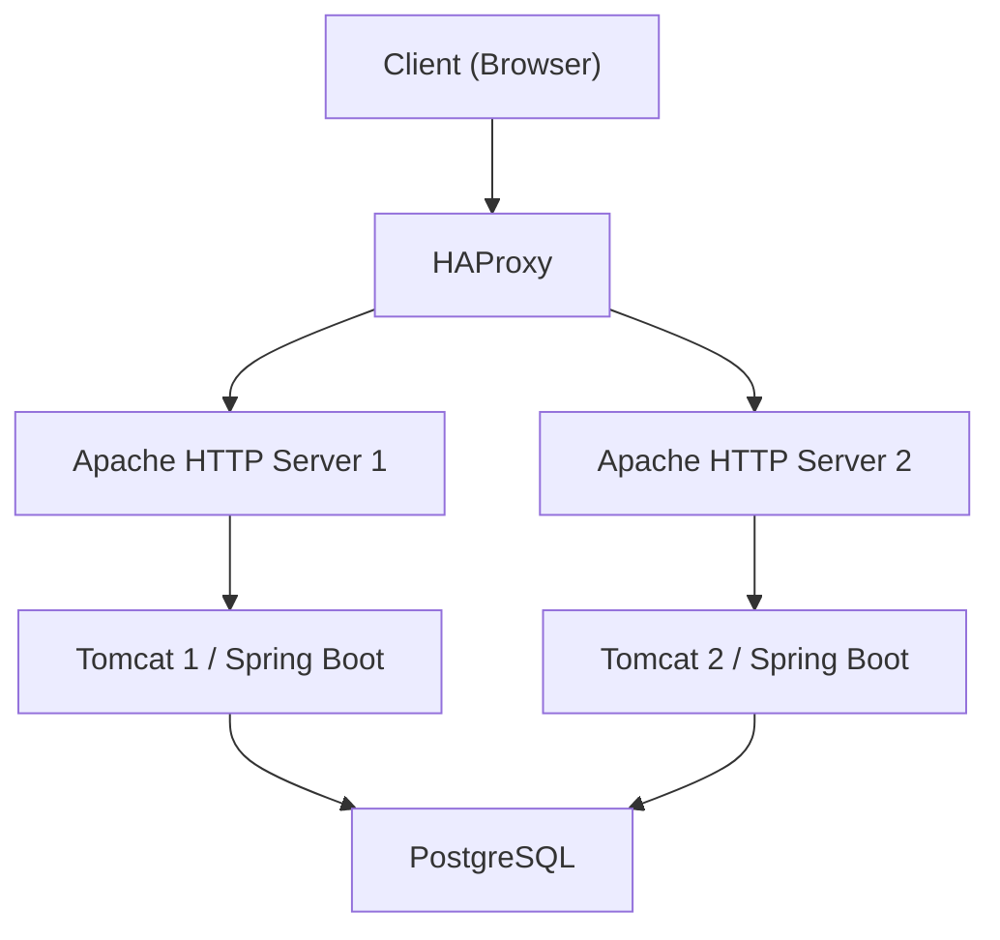

# MIRA（ Member Identity & Registration Administration）

MIRAは、JavaとSpring Bootを使用して開発する、学習用の簡易ユーザー管理システムです。

## 1. プロジェクト概要

本プロジェクトは、Webアプリケーション開発に必要な基本技術の習得を目的とします。

- ユーザー情報の登録・参照・更新・削除（CRUD）
- REST APIの設計・実装
- RDBによるデータ管理
- Dockerによる開発環境の構築
- Webサーバーとアプリケーションサーバーの連携

## 2. ディレクトリ構成

リポジトリの主要なディレクトリとファイルは次のとおりです。Docker 開発環境の詳細は [Docker 開発環境](docker/README.md) を参照してください。

```text
mira/
├── app/
│   ├── pom.xml
│   └── src/
│       ├── main/
│       │   ├── java/com/examplecompany/mira/
│       │   │   ├── api/       REST API のコントローラー
│       │   │   ├── web/       画面のコントローラー
│       │   │   ├── batch/     ユーザー自動削除ジョブ
│       │   │   └── common/    ユーザー管理の共通処理
│       │   └── resources/    設定や画面テンプレート
│       └── test/
│           ├── java/com/examplecompany/mira/  テストコード
│           └── resources/                    テスト用の設定やデータ
└── docker/
```

## 3. 技術スタック

| 分類           | 技術                      |
| ------------ | ----------------------- |
| 言語           | Java 17                 |
| フレームワーク      | Spring Boot             |
| Webサーバー      | Apache HTTP Server      |
| ロードバランサー | HAProxy |
| アプリケーションサーバー | Apache Tomcat |
| データベース       | PostgreSQL              |
| ビルドツール       | Maven                   |
| コンテナ         | Docker / Docker Compose |
| 実行 OS（アプリ・ミドルウェア） | Linux（Tomcat 等は Linux コンテナ内で動作。WAR は JVM 上で実行） |
| 開発ホスト OS     | **依存しない**（Docker / Compose で Linux コンテナを起動できればよい） |

## 4. システム構成



## 5. 主な機能

| 機能 | 種別 | 説明 |
| --- | --- | --- |
| ログイン画面 | 画面機能 | ログイン情報の入力と認証 |
| メインメニュー | 画面機能 | ログイン後に各機能へ移動 |
| ユーザー登録 | 画面機能・API機能 | 新規ユーザーの登録 |
| ユーザー一覧 | 画面機能 | 登録済みユーザーの一覧表示 |
| ユーザー詳細 | 画面機能・API機能 | 指定ユーザーの情報取得 |
| ユーザー編集 | 画面機能・API機能 | 登録済みユーザーの情報変更 |
| ユーザー削除 | 画面機能・API機能 | 登録済みユーザーの削除 |
| ユーザー自動削除 | バッチ機能 | 最終ログイン日から90日以上経過したユーザーを削除 |

## 6. 開発環境

Docker Compose を利用し、ロードバランサー、Web サーバー、アプリケーションサーバー、データベースをコンテナとして管理します。`compose.yaml` および `docker/` 配下の設定は、この前提で定義しています。

実行環境（Linux）の詳細は §3 技術スタックおよび [Docker 開発環境](docker/README.md) の「実行環境の想定」を参照してください。起動方法の概要は Docker Compose の構成確定後に追記します。

## 7. 開発方針

1. Dockerによる開発環境構築
2. Spring Bootアプリケーション作成
3. PostgreSQL接続
4. ユーザー管理REST API実装
5. 画面実装
6. 単体テスト・結合テスト

## 8. ステータス

開発準備中
