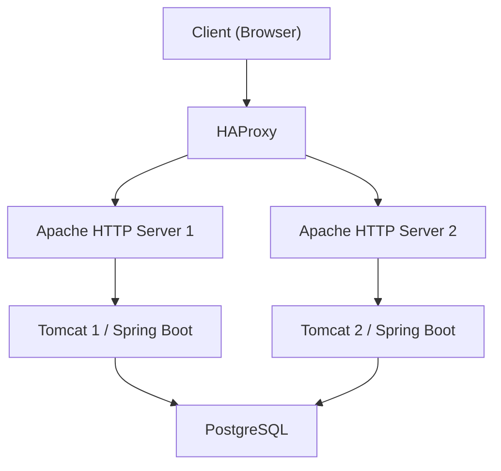

# MIRA（ Member Identity & Registration Administration）

MIRAは、JavaとSpring Bootを使用して開発する、学習用の簡易ユーザー管理システムです。

## 1. プロジェクト概要

本プロジェクトは、Webアプリケーション開発に必要な基本技術の習得を目的とします。

- ユーザー情報の登録・参照・更新・削除（CRUD）
- REST APIの設計・実装
- RDBによるデータ管理
- Dockerによる開発環境の構築
- Webサーバーとアプリケーションサーバーの連携

## 2. ディレクトリ構成

リポジトリの主要なディレクトリとファイルは次のとおりです。Docker 開発環境の詳細は [Docker 開発環境](docker/README.md) を参照してください。

```text
mira/
├── app/
│   ├── pom.xml
│   └── src/
│       ├── main/
│       │   ├── java/com/examplecompany/mira/
│       │   │   ├── api/       REST API のコントローラー
│       │   │   ├── web/       画面のコントローラー
│       │   │   ├── batch/     ユーザー自動削除ジョブ
│       │   │   └── common/    ユーザー管理の共通処理
│       │   └── resources/    設定や画面テンプレート
│       └── test/
│           ├── java/com/examplecompany/mira/  テストコード
│           └── resources/                    テスト用の設定やデータ
└── docker/
```

## 3. 技術スタック

| 分類           | 技術                      |
| ------------ | ----------------------- |
| 言語           | Java 17                 |
| フレームワーク      | Spring Boot             |
| Webサーバー      | Apache HTTP Server      |
| ロードバランサー | HAProxy |
| アプリケーションサーバー | Apache Tomcat |
| データベース       | PostgreSQL              |
| ビルドツール       | Maven                   |
| コンテナ         | Docker / Docker Compose |
| 実行 OS（アプリ・ミドルウェア） | Linux（Tomcat 等は Linux コンテナ内で動作。WAR は JVM 上で実行） |
| 開発ホスト OS     | **依存しない**（Docker / Compose で Linux コンテナを起動できればよい） |

## 4. システム構成



## 5. 主な機能

| 機能 | 種別 | 説明 |
| --- | --- | --- |
| ログイン画面 | 画面機能 | ログイン情報の入力と認証 |
| メインメニュー | 画面機能 | ログイン後に各機能へ移動 |
| ユーザー登録 | 画面機能・API機能 | 新規ユーザーの登録 |
| ユーザー一覧 | 画面機能 | 登録済みユーザーの一覧表示 |
| ユーザー詳細 | 画面機能・API機能 | 指定ユーザーの情報取得 |
| ユーザー編集 | 画面機能・API機能 | 登録済みユーザーの情報変更 |
| ユーザー削除 | 画面機能・API機能 | 登録済みユーザーの削除 |
| ユーザー自動削除 | バッチ機能 | 最終ログイン日から90日以上経過したユーザーを削除 |

## 6. 開発環境

リポジトリのルート（`compose.yaml` があるディレクトリ）で作業する。コンテナ構成の詳細は [Docker 開発環境](docker/README.md) を参照する。

### 前提

- [Docker Engine](https://docs.docker.com/engine/install/) と Docker Compose（`docker compose` コマンド）が使えること
- ホストの **8080 番ポート** が未使用であること（HAProxy の公開ポート）

### 手順 1: DB 用パスワードファイルを用意する

DB 接続パスワードは **`docker/confidential/db.env`** に置く（**`db.env` のみ** Git にコミットしない。共有ファイルサーバーから取得してもよい）。

初回のみ、雛形をコピーして値を編集する。

**PowerShell（Windows）**

```powershell
New-Item -ItemType Directory -Force -Path docker\confidential | Out-Null
Copy-Item docker\confidential\db.env.example docker\confidential\db.env
notepad docker\confidential\db.env
```

**bash（Linux / macOS）**

```bash
mkdir -p docker/confidential
cp docker/confidential/db.env.example docker/confidential/db.env
```

`docker/confidential/db.env` の **`POSTGRES_PASSWORD`** と **`SPRING_DATASOURCE_PASSWORD`** を同じ値に設定する（Compose が各コンテナへ渡す）。

### 手順 2: コンテナを起動する

初回または `app/` の変更後はイメージのビルドを含める。

```bash
docker compose up --build -d
```

2 回目以降の起動のみなら次でもよい。

```bash
docker compose up -d
```

起動する主なサービスは HAProxy、Apache HTTP Server（2 台）、Tomcat（2 台、WAR 展開）、PostgreSQL である。Tomcat は PostgreSQL のヘルスチェック通過後に起動する。初回起動は WAR のビルドと DB 初期化のため数分かかることがある。

ログを追う場合:

```bash
docker compose logs -f tomcat-1
```

アプリがデプロイされると、Tomcat のログに Spring Boot の起動完了が出る。

### 手順 3: ログイン画面を開く

ブラウザーで次の URL を開く。

[http://127.0.0.1:8080/login](http://127.0.0.1:8080/login)

（`localhost:8080` でもよい。ホスト側は `127.0.0.1:8080` → HAProxy → Apache → Tomcat へ中継される。）

### 手順 4: ログイン試行（開発用）

PostgreSQL 初回起動時に `docker/postgres/init/02_seed_admin.sql` で投入される管理者ユーザーを使う。

| 項目 | 値 |
| --- | --- |
| ログイン ID | `admin` |
| パスワード | `admin` |

認証に成功するとメインメニュー（`/menu`）へ遷移する。

### 停止

```bash
docker compose down
```

データは名前付きボリューム `postgres_data` に残る。DB を初期状態からやり直す場合は `docker compose down -v` でボリュームも削除してから再度 `up` する（**データは消える**）。

## 7. 開発方針

1. Dockerによる開発環境構築
2. Spring Bootアプリケーション作成
3. PostgreSQL接続
4. ユーザー管理REST API実装
5. 画面実装
6. 単体テスト・結合テスト

## 8. ステータス

開発準備中
