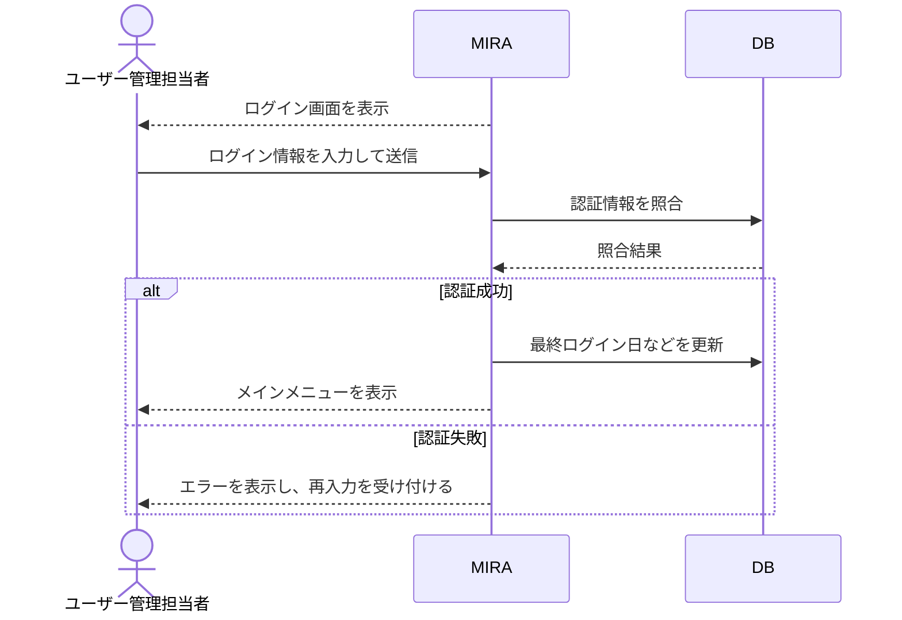
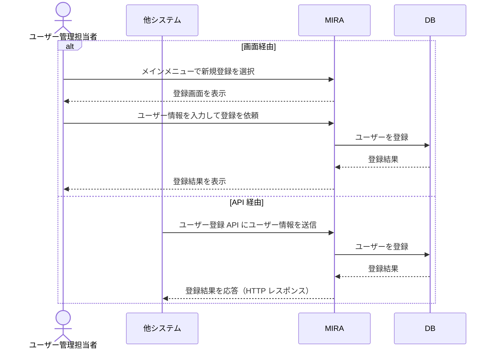
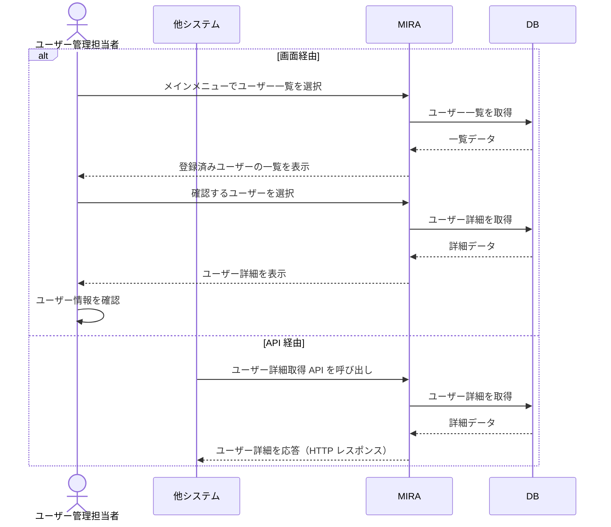
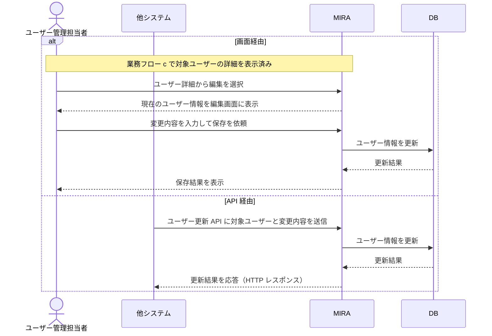
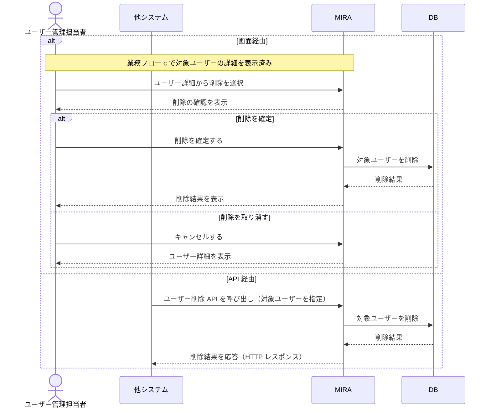
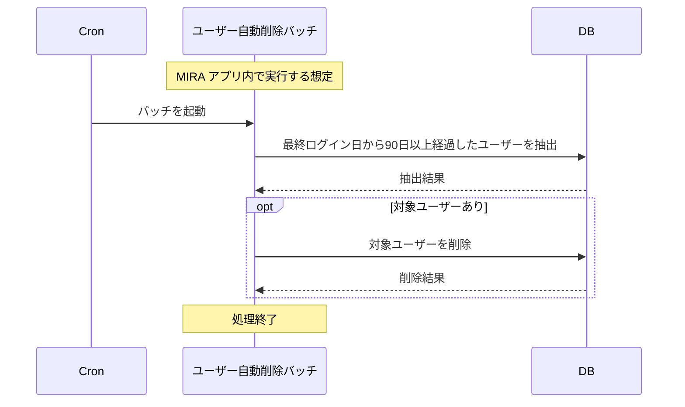

# MIRA 業務要件

## アクター

| アクター | 説明 |
| --- | --- |
| ユーザー管理担当者 | MIRA にログインし、画面からユーザー管理業務を行う |
| 他システム | REST API を呼び出し、ユーザー登録などの処理を依頼する |
| MIRA | ログイン・画面・REST API・バッチを提供するアプリケーション |
| DB | ユーザー情報を登録・参照・更新・削除し、永続化する |

## ユーザー管理の業務フロー

| ID | 業務名 |
| --- | --- |
| a | ログイン業務 |
| b | ユーザー新規登録業務 |
| c | ユーザー確認業務 |
| d | ユーザー編集業務 |
| e | ユーザー削除業務 |
| f | 長期間ログインしていないユーザーの自動削除 |

### a. ログイン業務

本業務は画面でのみ実施する（メインメニューへの遷移までを含む）。

### b. ユーザー新規登録業務

画面（ログイン後のメニュー）または REST API のいずれからも、新規ユーザーを登録できる。登録処理はいずれも MIRA が受け付け、DB に保存する。

### c. ユーザー確認業務

ユーザー一覧の把握は画面のみ行う。ユーザー詳細の取得は、画面または REST API のいずれからも行える。

### d. ユーザー編集業務

画面からの編集または REST API による更新のいずれでも、ユーザー情報を変更できる。

### e. ユーザー削除業務

画面からの削除（確認あり）または REST API による削除のいずれでも、ユーザーを削除できる。

### f. 長期間ログインしていないユーザーの自動削除

定期バッチは、最終ログイン日から90日以上経過したユーザーを削除する。該当するユーザーがいなければ処理を終了する。

バッチの実行時刻と、ログイン履歴がないユーザーの扱いは今後決定する。
