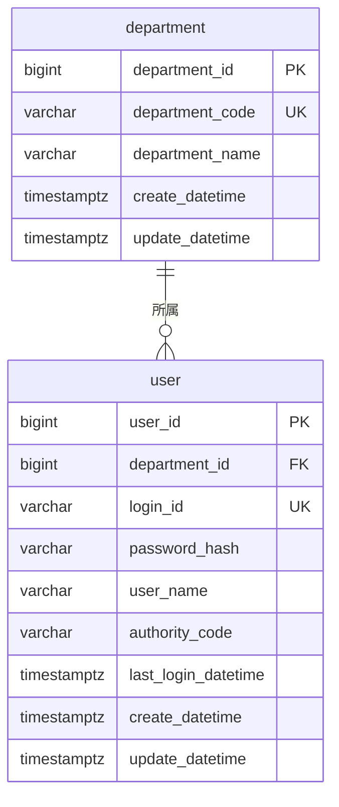

# MIRA DB 定義

MIRA の永続データは **PostgreSQL 17** に格納する。接続先データベース名・接続ユーザーは開発環境で `mira`（[docker/README.md](../../../docker/README.md) No.5）。業務上の役割は [業務要件](../business-requirements/README.md) を参照する。

## 1. 概要

| 項目 | 内容 |
| --- | --- |
| DBMS | PostgreSQL 17 |
| データベース名 | `mira` |
| 文字エンコーディング | UTF-8（PostgreSQL デフォルト） |
| タイムゾーン | アプリ層で `timestamptz` を用い、表示はアプリで制御する |

永続化するマスタは **部門** と **ユーザー** の 2 テーブルのみとする。ユーザーは必ず 1 つの部門に所属する（外部キー）。

### 制約列の記号（PK / FK / UK）

| 略語 | 意味 | 表での表記 |
| --- | --- | --- |
| PK | Primary Key（主キー） | ○ |
| FK | Foreign Key（外部キー） | 参照先テーブル.カラム（例: `department.department_id`） |
| UK | Unique Key（一意制約） | ○ |

該当しない場合は **—** とする。

## 2. ER 図

## 3. テーブル一覧

| 論理名 | 物理名 | 説明 |
| --- | --- | --- |
| 部門 | `department` | 組織の部門マスタ |
| ユーザー | `user` | MIRA にログインし業務を行うユーザー（部門に所属） |

補足: 物理テーブル名 `user` は PostgreSQL の予約語のため、DDL では `"user"` と引用符で囲む。

## 4. テーブル定義

### 4.1 `department`（部門）

| 物理名 | 論理名称 | データ型 | PK | FK | UK |
| --- | --- | --- | --- | --- | --- |
| `department_id` | 部門 ID | `BIGSERIAL` | ○ | — | — |
| `department_code` | 部門コード | `VARCHAR(32)` | — | — | ○ |
| `department_name` | 部門名 | `VARCHAR(128)` | — | — | — |
| `create_datetime` | 登録日時 | `TIMESTAMPTZ` | — | — | — |
| `update_datetime` | 更新日時 | `TIMESTAMPTZ` | — | — | — |

補足: `create_datetime` / `update_datetime` のデフォルトは `CURRENT_TIMESTAMP`。

### 4.2 `user`（ユーザー）

| 物理名 | 論理名称 | データ型 | PK | FK | UK |
| --- | --- | --- | --- | --- | --- |
| `user_id` | ユーザー ID | `BIGSERIAL` | ○ | — | — |
| `department_id` | 部門 ID | `BIGINT` | — | `department.department_id` | — |
| `login_id` | ログイン ID | `VARCHAR(64)` | — | — | ○ |
| `password_hash` | パスワードハッシュ | `VARCHAR(255)` | — | — | — |
| `user_name` | ユーザー名 | `VARCHAR(128)` | — | — | — |
| `authority_code` | 権限コード | `VARCHAR(32)` | — | — | — |
| `last_login_datetime` | 最終ログイン日時 | `TIMESTAMPTZ` | — | — | — |
| `create_datetime` | 登録日時 | `TIMESTAMPTZ` | — | — | — |
| `update_datetime` | 更新日時 | `TIMESTAMPTZ` | — | — | — |

補足: `password_hash` は平文を保存しない。`authority_code` の例は `ADMIN`（管理者）、`GENERAL`（一般）。未指定時のデフォルトは `GENERAL`。FK `department_id` の削除時動作は **RESTRICT**（所属ユーザーがいる部門は削除不可）。

**インデックス（UK 以外）**

| 名称 | カラム | 用途 |
| --- | --- | --- |
| `user_department_id_idx` | `department_id` | 部門別のユーザー検索 |

## 5. 業務ルールとの対応

| 業務・ルール | DB 上の扱い |
| --- | --- |
| ログイン（業務フロー a） | `user` を `login_id` で参照し、`password_hash` を照合。成功時に `last_login_datetime` を更新 |
| 部門・ユーザーの管理 | `department` / `user` に対する CRUD（機能設計で画面・API を定義） |
| パスワード | DB 接続パスワードは `docker/confidential/db.env`（No.5）。ログイン用パスワードは `password_hash` のみ保存 |
| 管理者 | `authority_code` = `ADMIN`。開発環境の初期データは [`02_seed_admin.sql`](../../../docker/postgres/init/02_seed_admin.sql) |

## 6. DDL

テーブル定義の SQL（実行用 DDL）は **`docker/postgres/init/`** 配下に置く。`01_schema.sql` で `department` を先に作成し、続けて `02_seed_admin.sql` で初期管理者ユーザーを投入する（ファイル名順に実行）。PostgreSQL コンテナの初回起動時（データ領域が空のとき）に `compose.yaml` で `docker/postgres/init` を `/docker-entrypoint-initdb.d` にマウントして適用する。スキーマの説明は本ドキュメント、物理ファイルの管理は [docker/README.md](../../../docker/README.md) No.5 を参照する。

## 7. 関連ドキュメント

| ドキュメント | 内容 |
| --- | --- |
| [業務要件](../business-requirements/README.md) | 業務フロー |
| [docker/README.md](../../../docker/README.md) No.5 | 接続・永続化 |
| [プロジェクト README](../../../README.md) | 機能一覧 |