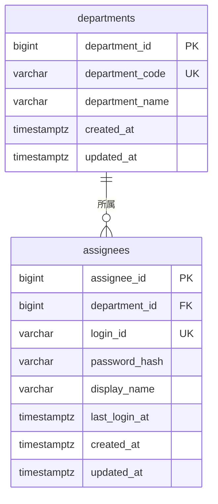

# MIRA DB 定義

MIRA の永続データは **PostgreSQL 17** に格納する。接続先データベース名・接続ユーザーは開発環境で `mira`（[docker/README.md](../../../docker/README.md) No.5）。業務上の役割は [業務要件](../business-requirements/README.md) を参照する。

## 1. 概要

| 項目 | 内容 |
| --- | --- |
| DBMS | PostgreSQL 17 |
| データベース名 | `mira` |
| 文字エンコーディング | UTF-8（PostgreSQL デフォルト） |
| タイムゾーン | アプリ層で `timestamptz` を用い、表示はアプリで制御する |

永続化するマスタは **部門** と **担当者** の 2 テーブルのみとする。担当者は必ず 1 つの部門に所属する（外部キー）。

### 制約列の記号（PK / FK / UK）

| 略語 | 意味 | 表での表記 |
| --- | --- | --- |
| PK | Primary Key（主キー） | ○ |
| FK | Foreign Key（外部キー） | 参照先テーブル.カラム（例: `departments.department_id`） |
| UK | Unique Key（一意制約） | ○ |

該当しない場合は **—** とする。

## 2. ER 図

## 3. テーブル一覧

| 論理名 | 物理名 | 説明 |
| --- | --- | --- |
| 部門 | `departments` | 組織の部門マスタ |
| 担当者 | `assignees` | MIRA にログインし業務を行う担当者（部門に所属） |

## 4. テーブル定義

### 4.1 `departments`（部門）

| 物理名 | 論理名称 | データ型 | PK | FK | UK |
| --- | --- | --- | --- | --- | --- |
| `department_id` | 部門 ID | `BIGSERIAL` | ○ | — | — |
| `department_code` | 部門コード | `VARCHAR(32)` | — | — | ○ |
| `department_name` | 部門名 | `VARCHAR(128)` | — | — | — |
| `created_at` | 登録日時 | `TIMESTAMPTZ` | — | — | — |
| `updated_at` | 更新日時 | `TIMESTAMPTZ` | — | — | — |

補足: `created_at` / `updated_at` のデフォルトは `CURRENT_TIMESTAMP`。

### 4.2 `assignees`（担当者）

| 物理名 | 論理名称 | データ型 | PK | FK | UK |
| --- | --- | --- | --- | --- | --- |
| `assignee_id` | 担当者 ID | `BIGSERIAL` | ○ | — | — |
| `department_id` | 部門 ID | `BIGINT` | — | `departments.department_id` | — |
| `login_id` | ログイン ID | `VARCHAR(64)` | — | — | ○ |
| `password_hash` | パスワードハッシュ | `VARCHAR(255)` | — | — | — |
| `display_name` | 担当者名 | `VARCHAR(128)` | — | — | — |
| `last_login_at` | 最終ログイン日時 | `TIMESTAMPTZ` | — | — | — |
| `created_at` | 登録日時 | `TIMESTAMPTZ` | — | — | — |
| `updated_at` | 更新日時 | `TIMESTAMPTZ` | — | — | — |

補足: `password_hash` は平文を保存しない。FK `department_id` の削除時動作は **RESTRICT**（所属担当者がいる部門は削除不可）。

**インデックス（UK 以外）**

| 名称 | カラム | 用途 |
| --- | --- | --- |
| `assignees_department_id_idx` | `department_id` | 部門別の担当者検索 |

## 5. 業務ルールとの対応

| 業務・ルール | DB 上の扱い |
| --- | --- |
| 担当者ログイン（BF-01） | `assignees` を `login_id` で参照し、`password_hash` を照合。成功時に `last_login_at` を更新 |
| 部門・担当者の管理 | `departments` / `assignees` に対する CRUD（機能設計で画面・API を定義） |
| パスワード | DB 接続パスワードは環境変数 `MIRA_DB_PASSWORD`（No.5）。担当者パスワードは `password_hash` のみ保存 |

## 6. DDL

テーブル定義の SQL（実行用 DDL）は **`docker/postgres/init/`** 配下に置く（例: [`01_schema.sql`](../../../docker/postgres/init/01_schema.sql)）。`departments` を先に作成する。PostgreSQL コンテナの初回起動時（データ領域が空のとき）に `compose.yaml` で `docker/postgres/init` を `/docker-entrypoint-initdb.d` にマウントして適用する。スキーマの説明は本ドキュメント、物理ファイルの管理は [docker/README.md](../../../docker/README.md) No.5 を参照する。

## 7. 関連ドキュメント

| ドキュメント | 内容 |
| --- | --- |
| [業務要件](../business-requirements/README.md) | 業務フロー |
| [docker/README.md](../../../docker/README.md) No.5 | 接続・永続化 |
| [プロジェクト README](../../../README.md) | 機能一覧 |