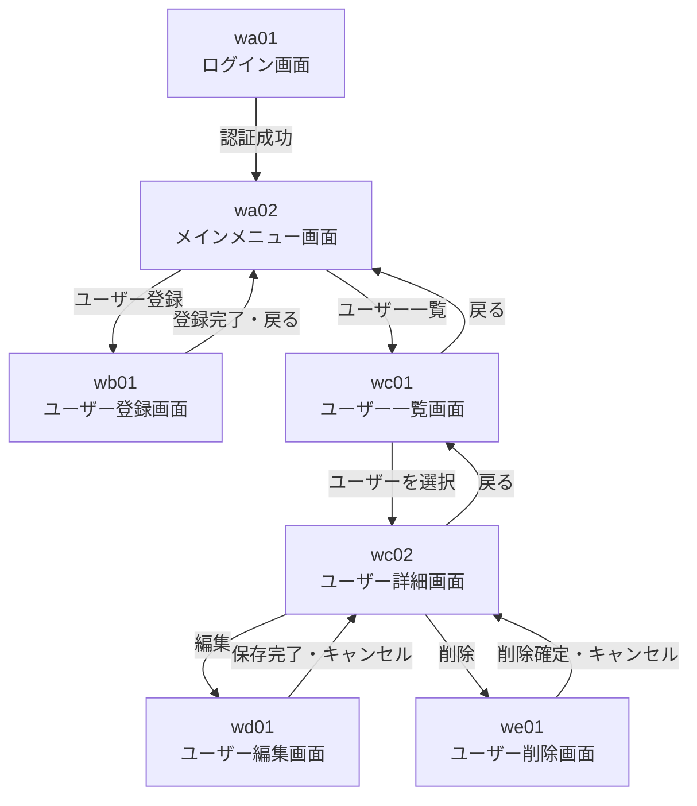

# MIRA 機能設計

## 設計書一覧

| 機能 ID | 機能名 | 機能概要 |
| --- | --- | --- |
| wa01 | [ログイン画面](./wa01-login.md) | ログイン情報の入力と認証 |
| wa02 | [メインメニュー画面](./wa02-main-menu.md) | ログイン後に各機能へ移動 |
| wb01 | [ユーザー登録画面](./wb01-user-registration.md) | 新規ユーザーの登録（画面） |
| ab01 | [ユーザー登録 API](./ab01-user-registration-api.md) | 新規ユーザーの登録（REST API） |
| wc01 | [ユーザー一覧画面](./wc01-user-list.md) | 登録済みユーザーの一覧表示 |
| wc02 | [ユーザー詳細画面](./wc02-user-detail.md) | 指定ユーザーの情報を画面で表示 |
| ac01 | [ユーザー取得 API](./ac01-user-get-api.md) | 指定ユーザーの情報取得（REST API） |
| wd01 | [ユーザー編集画面](./wd01-user-edit.md) | 登録済みユーザーの情報変更（画面） |
| ad01 | [ユーザー更新 API](./ad01-user-update-api.md) | 登録済みユーザーの情報変更（REST API） |
| we01 | [ユーザー削除画面](./we01-user-delete.md) | 登録済みユーザーの削除（画面） |
| ae01 | [ユーザー削除 API](./ae01-user-delete-api.md) | 登録済みユーザーの削除（REST API） |
| bf01 | [ユーザー自動削除](./bf01-user-auto-delete.md) | 最終ログイン日から 90 日以上経過したユーザーを削除（バッチ） |

## 画面遷移図

Web 画面（機能 ID が `w` で始まるもの）の遷移。REST API・バッチは含めない。未ログインで画面にアクセスした場合は **wa01** へ遷移する。

## 機能 ID 採番体系

機能 ID は **4 文字**（英小文字 2 字 + 連番 2 桁）とする。形式は `{種別}{業務区分}{連番}`（例: `wa01`、`ab01`）。

### 1 文字目（種別）

| 記号 | 種別 | 説明 |
| --- | --- | --- |
| w | Web 画面 | ブラウザー向け画面機能 |
| a | REST API | 他システム等から呼び出す API |
| b | バッチ | スケジュール実行のバッチ処理 |

### 2 文字目（業務区分）

[業務要件](../business-requirements/README.md) の業務フロー ID（a ～ f）に対応する。

| 記号 | 業務フロー | 業務の例 |
| --- | --- | --- |
| a | a | ログイン、メインメニュー |
| b | b | ユーザー新規登録 |
| c | c | ユーザー一覧・詳細、ユーザー取得 |
| d | d | ユーザー編集・更新 |
| e | e | ユーザー削除 |
| f | f | 長期間未ログインユーザーの自動削除 |

### 3～4 文字目（連番）

同一 **種別** かつ同一 **業務区分** 内で `01` から昇順に採番する。複数画面や API がない場合は `01` のみとする。

### 採番例

| 機能 ID | 分解 | 意味 |
| --- | --- | --- |
| wa01 | w + a + 01 | 画面・ログイン系の 1 件目（ログイン画面） |
| wa02 | w + a + 02 | 画面・ログイン系の 2 件目（メインメニュー画面） |
| ab01 | a + b + 01 | API・登録系の 1 件目（ユーザー登録 API） |
| ac01 | a + c + 01 | API・確認系の 1 件目（ユーザー取得 API） |
| bf01 | b + f + 01 | バッチ・自動削除系の 1 件目（ユーザー自動削除） |