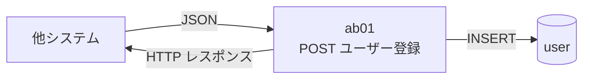

# ユーザー登録 API（ab01）

| 項目 | 内容 |
| --- | --- |
| 機能 ID | ab01 |
| 機能名 | ユーザー登録 API |
| 種別 | REST API |
| 業務フロー | [b. ユーザー新規登録業務](../business-requirements/README.md#b-ユーザー新規登録業務) |
| 関連機能 | [ユーザー登録画面（wb01）](./wb01-user-registration.md) |

## 1. 機能概要

他システムが REST API 経由で新規ユーザーを登録する。リクエスト body の属性を精査し、問題がなければ `user` テーブルへ INSERT する（パスワードはハッシュ化して `password_hash` に保存）。`authority_code` 未指定時は `GENERAL` とする。画面経由の登録は [wb01](./wb01-user-registration.md) で定義し、本設計書は API のみを対象とする。

## 2. 機能内操作

機能 ID **ab01** は単一エンドポイントとする。

## 3. ユーザー登録

### 3.1 入出力一覧

種別は **ファイル** および **テーブル** のみとする。本 API では **ファイル** の入出力は行わない。

DB アクセス種別: **○** は該当、**—** は非該当。C = 登録、R = 参照、U = 更新、D = 削除。

| No. | 入出力名 | 種別 | I/O | C | R | U | D | ロック対象 | 備考 |
| ---: | --- | --- | :---: | :---: | :---: | :---: | :---: | :---: | --- |
| 1 | `department` | テーブル | I | — | ○ | — | — | — | `department_id` の存在確認 |
| 2 | `user` | テーブル | I/O | ○ | ○ | — | — | — | `login_id` 重複確認（R）、INSERT（C） |

### 3.2 リクエスト／レスポンス概要

| 項目 | 内容 |
| --- | --- |
| 目的 | 新規ユーザーの登録 |
| 認証 | 実装時に定義（API キー・OAuth 等） |

### 3.3 パラメータ一覧

| No. | 項目種別 | 項目名（JSON） | 必須 | 対応 DB 項目 | 型（例） | 備考 |
| ---: | --- | --- | ---: | --- | --- | --- |
| 1 | 入力 | `department_id` | ○ | `user.department_id` | 数値 | 存在する部門 ID |
| 2 | 入力 | `login_id` | ○ | `user.login_id` | 文字列 | 最大 64 文字、重複不可（UK） |
| 3 | 入力 | `password` | ○ | → `user.password_hash` | 文字列 | 平文。サーバーでハッシュ化 |
| 4 | 入力 | `user_name` | ○ | `user.user_name` | 文字列 | 最大 128 文字 |
| 5 | 入力 | `authority_code` | — | `user.authority_code` | 文字列 | 省略時 `GENERAL`。例: `ADMIN` / `GENERAL` |

レスポンス body は実装時に定義する（登録した `user_id` 等を返す想定）。

### 3.4 処理イベント一覧

HTTP およびパスは実装時の目安とする。

| No. | イベント名 | イベント概要 | トリガー | 結果 | HTTP | パス（例） |
| ---: | --- | --- | --- | --- | --- | --- |
| 1 | 登録 | 入力を精査し、OK なら `user` に登録する | `POST` 要求 | 成功時 201 等 | POST | `/api/users` |

### 3.5 処理イベント詳細

#### 3.5.1 登録

1. 認証・認可を行う（方式は実装時に定義）。
2. 下表のとおり入力値精査を行う。
3. `login_id` の重複がなければ INSERT を実行する。
4. 成功時は登録結果を HTTP レスポンスで返す。

| 対象 | ルール | エラー時の扱い |
| --- | --- | --- |
| `department_id` | 必須、`department` に存在すること | 4xx レスポンス |
| `login_id` | 必須、長さ ≤ 64、未登録（UK） | 4xx レスポンス |
| `password` | 必須、ポリシーは実装時に定義 | 4xx レスポンス |
| `user_name` | 必須、長さ ≤ 128 | 4xx レスポンス |
| `authority_code` | 指定時は許容値のみ | 4xx レスポンス |

**エラー・例外**

| 状況 | API の扱い |
| --- | --- |
| 入力値精査エラー | 4xx、エラー内容を body で返す |
| `login_id` 重複 | 4xx（例: 409 Conflict） |
| 認証失敗 | 401 |
| DB エラー | 5xx（方針はエラーハンドリング設計で定義予定） |