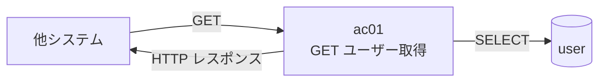

# ユーザー取得 API（ac01）

| 項目 | 内容 |
| --- | --- |
| 機能 ID | ac01 |
| 機能名 | ユーザー取得 API |
| 種別 | REST API |
| 業務フロー | [c. ユーザー確認業務](../business-requirements/README.md#c-ユーザー確認業務) |
| 関連機能 | [ユーザー詳細画面（wc02）](./wc02-user-detail.md) |

## 1. 機能概要

他システムが REST API 経由で、指定ユーザー ID の情報を取得する。`password_hash` はレスポンスに含めない。一覧 API は本プロジェクトでは画面（wc01）のみとし、本 API は単一ユーザー取得のみを対象とする。

## 2. 処理フロー

機能 ID **ac01** は単一エンドポイントとする。

## 3. ユーザー取得

### 3.1 入出力一覧

種別は **ファイル** および **テーブル** のみとする。本 API では **ファイル** の入出力は行わない。

DB アクセス種別: **○** は該当、**—** は非該当。C = 登録、R = 参照、U = 更新、D = 削除。

| No. | 入出力名 | 種別 | I/O | C | R | U | D | ロック対象 | 備考 |
| ---: | --- | --- | :---: | :---: | :---: | :---: | :---: | :---: | --- |
| 1 | `user` | テーブル | O | — | ○ | — | — | — | `user_id` 指定で参照 |
| 2 | `department` | テーブル | O | — | ○ | — | — | — | 部門名等の付加情報用（任意） |

### 3.2 リクエスト／レスポンス概要

| 項目 | 内容 |
| --- | --- |
| 目的 | 指定ユーザーの属性取得 |
| 認証 | 実装時に定義 |

### 3.3 パラメータ一覧

| No. | 項目種別 | 項目名 | 必須 | 対応 DB 項目 | 型（例） | 備考 |
| ---: | --- | --- | ---: | --- | --- | --- |
| 1 | パス | `user_id` | ○ | `user.user_id` | 数値 | URL パスに含める |

レスポンス body の属性例: `user_id`、`department_id`、`login_id`、`user_name`、`authority_code`、`last_login_datetime`、`create_datetime`、`update_datetime`（`password_hash` は除く）。部門コード・部門名を含めるかは実装時に定義。

### 3.4 処理イベント一覧

HTTP およびパスは実装時の目安とする。

| No. | イベント名 | イベント概要 | トリガー | 結果 | HTTP | パス（例） |
| ---: | --- | --- | --- | --- | --- | --- |
| 1 | 取得 | 指定ユーザーを DB から読み取り返す | `GET` 要求 | 成功時 200 | GET | `/api/users/{userId}` |

### 3.5 処理イベント詳細

#### 3.5.1 取得

1. 認証・認可を行う。
2. `user_id` を精査する（必須、数値、正の整数等は実装時に定義）。
3. 該当行があれば JSON で返す。なければ 404。

**エラー・例外**

| 状況 | API の扱い |
| --- | --- |
| パラメータ不正 | 400 |
| 認証失敗 | 401 |
| ユーザー不存在 | 404 |
| DB エラー | 5xx |