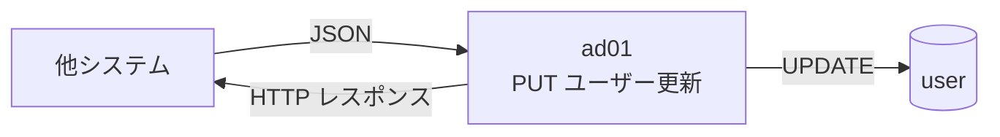

# ユーザー更新 API（ad01）

| 項目 | 内容 |
| --- | --- |
| 機能 ID | ad01 |
| 機能名 | ユーザー更新 API |
| 種別 | REST API |
| 業務フロー | [d. ユーザー編集業務](../business-requirements/README.md#d-ユーザー編集業務) |
| 関連機能 | [ユーザー編集画面（wd01）](./wd01-user-edit.md) |

## 1. 機能概要

他システムが REST API 経由で、指定ユーザーの属性を更新する。`login_id` の変更は本 API では想定しない（パスは `user_id` で指定）。画面経由の編集は [wd01](./wd01-user-edit.md) を参照する。

## 2. 処理フロー

機能 ID **ad01** は単一エンドポイントとする。

## 3. ユーザー更新

### 3.1 入出力一覧

種別は **ファイル** および **テーブル** のみとする。本 API では **ファイル** の入出力は行わない。

DB アクセス種別: **○** は該当、**—** は非該当。C = 登録、R = 参照、U = 更新、D = 削除。

| No. | 入出力名 | 種別 | I/O | C | R | U | D | ロック対象 | 備考 |
| ---: | --- | --- | :---: | :---: | :---: | :---: | :---: | :---: | --- |
| 1 | `department` | テーブル | I | — | ○ | — | — | — | `department_id` の存在確認 |
| 2 | `user` | テーブル | I | — | ○ | — | — | — | 存在確認（R） |
| 3 | `user` | テーブル | O | — | — | ○ | — | — | UPDATE（U） |

### 3.2 リクエスト／レスポンス概要

| 項目 | 内容 |
| --- | --- |
| 目的 | 指定ユーザーの属性更新 |
| HTTP メソッド | `PUT` |
| 認証 | 実装時に定義 |

### 3.3 パラメータ一覧

| No. | 項目種別 | 項目名 | 必須 | 対応 DB 項目 | 型（例） | 備考 |
| ---: | --- | --- | ---: | --- | --- | --- |
| 1 | パス | `user_id` | ○ | `user.user_id` | 数値 | URL パス |
| 2 | 入力 | `department_id` | — | `user.department_id` | 数値 | 指定時は存在する部門 ID |
| 3 | 入力 | `user_name` | — | `user.user_name` | 文字列 | 最大 128 文字 |
| 4 | 入力 | `password` | — | → `user.password_hash` | 文字列 | 指定時のみハッシュ更新 |
| 5 | 入力 | `authority_code` | — | `user.authority_code` | 文字列 | 許容値のみ |

リクエストで指定した項目を更新し、省略した項目は現在の値を維持する。`update_datetime` はサーバー側で更新する。

### 3.4 処理イベント一覧

HTTP およびパスは実装時の目安とする。

| No. | イベント名 | イベント概要 | トリガー | 結果 | HTTP | パス（例） |
| ---: | --- | --- | --- | --- | --- | --- |
| 1 | 更新 | 入力を精査し、OK なら `user` を更新する | `PUT` 要求 | 成功時 200 | PUT | `/api/users/{userId}` |

### 3.5 処理イベント詳細

#### 3.5.1 更新

1. 認証・認可を行う。
2. 対象 `user_id` の存在を確認する。
3. 下表のとおり入力値精査を行う。
4. UPDATE を実行し、結果をレスポンスで返す。

| 対象 | ルール | エラー時の扱い |
| --- | --- | --- |
| `user_id`（パス） | 必須、存在すること | 404 |
| `department_id` | 指定時は `department` に存在 | 4xx |
| `user_name` | 指定時は必須相当、長さ ≤ 128 | 4xx |
| `password` | 指定時はポリシー適合 | 4xx |
| `authority_code` | 指定時は許容値のみ | 4xx |

**エラー・例外**

| 状況 | API の扱い |
| --- | --- |
| 入力値精査エラー | 400 |
| 認証失敗 | 401 |
| ユーザー不存在 | 404 |
| DB エラー | 5xx |
