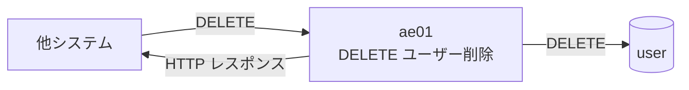

# ユーザー削除 API（ae01）

| 項目 | 内容 |
| --- | --- |
| 機能 ID | ae01 |
| 機能名 | ユーザー削除 API |
| 種別 | REST API |
| 業務フロー | [e. ユーザー削除業務](../business-requirements/README.md#e-ユーザー削除業務) |
| 関連機能 | [ユーザー削除画面（we01）](./we01-user-delete.md) |

## 1. 機能概要

他システムが REST API 経由で、指定ユーザーを削除する。画面経由の削除確認は [we01](./we01-user-delete.md) で定義し、本 API は確認 UI を伴わず、呼び出し側が責任を持って削除を依頼する想定とする。

## 2. 処理フロー

機能 ID **ae01** は単一エンドポイントとする。

## 3. ユーザー削除

### 3.1 入出力一覧

種別は **ファイル** および **テーブル** のみとする。本 API では **ファイル** の入出力は行わない。

DB アクセス種別: **○** は該当、**—** は非該当。C = 登録、R = 参照、U = 更新、D = 削除。

| No. | 入出力名 | 種別 | I/O | C | R | U | D | ロック対象 | 備考 |
| ---: | --- | --- | :---: | :---: | :---: | :---: | :---: | :---: | --- |
| 1 | `user` | テーブル | I | — | ○ | — | — | — | 存在確認（R） |
| 2 | `user` | テーブル | O | — | — | — | ○ | — | DELETE（D） |

### 3.2 リクエスト／レスポンス概要

| 項目 | 内容 |
| --- | --- |
| 目的 | 指定ユーザーの削除 |
| 認証 | 実装時に定義 |

### 3.3 パラメータ一覧

| No. | 項目種別 | 項目名 | 必須 | 対応 DB 項目 | 型（例） | 備考 |
| ---: | --- | --- | ---: | --- | --- | --- |
| 1 | パス | `user_id` | ○ | `user.user_id` | 数値 | URL パス |

レスポンス body は実装時に定義する（成功時 204 No Content 等を想定）。

### 3.4 処理イベント一覧

HTTP およびパスは実装時の目安とする。

| No. | イベント名 | イベント概要 | トリガー | 結果 | HTTP | パス（例） |
| ---: | --- | --- | --- | --- | --- | --- |
| 1 | 削除 | 指定ユーザーを DB から削除する | `DELETE` 要求 | 成功時 204 等 | DELETE | `/api/users/{userId}` |

### 3.5 処理イベント詳細

#### 3.5.1 削除

1. 認証・認可を行う。
2. 対象 `user_id` の存在を確認する。
3. 業務上削除不可の場合はエラーを返す（自己削除禁止等は実装時に定義）。
4. DELETE を実行し、結果をレスポンスで返す。

**エラー・例外**

| 状況 | API の扱い |
| --- | --- |
| パラメータ不正 | 400 |
| 認証失敗 | 401 |
| ユーザー不存在 | 404 |
| 削除不可（業務ルール違反） | 4xx（例: 409） |
| DB エラー | 5xx |