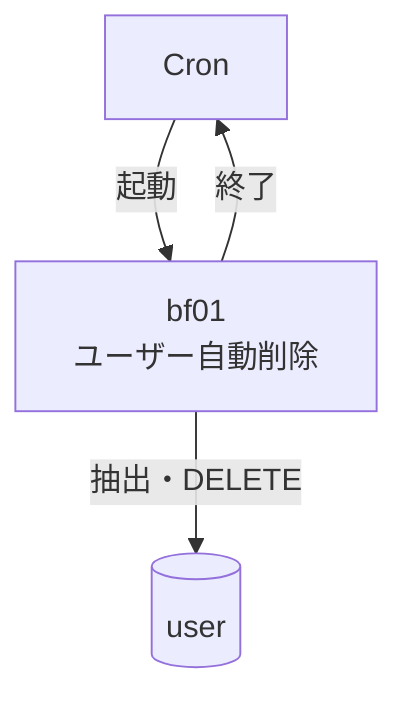

# ユーザー自動削除（bf01）

| 項目 | 内容 |
| --- | --- |
| 機能 ID | bf01 |
| 機能名 | ユーザー自動削除 |
| 種別 | バッチ |
| 業務フロー | [f. 長期間ログインしていないユーザーの自動削除](../business-requirements/README.md#f-長期間ログインしていないユーザーの自動削除) |
| 関連機能 | — |

## 1. 機能概要

Cron 等から定期起動され、最終ログイン日時（`last_login_datetime`）から **90 日以上** 経過したユーザーを `user` テーブルから削除する。該当ユーザーがいない場合は抽出結果が空となり、削除処理は行わず正常終了する。実行時刻および `last_login_datetime` が NULL のユーザーの扱いは実装時に定義する（[業務要件](../business-requirements/README.md) 参照）。

## 2. 処理フロー

機能 ID **bf01** は単一ジョブとする。

## 3. ユーザー自動削除ジョブ

### 3.1 入出力一覧

種別は **ファイル** および **テーブル** のみとする。本バッチでは **ファイル** の入出力は行わない（ログ出力ファイルは実装時に定義）。

DB アクセス種別: **○** は該当、**—** は非該当。C = 登録、R = 参照、U = 更新、D = 削除。

| No. | 入出力名 | 種別 | I/O | C | R | U | D | ロック対象 | 備考 |
| ---: | --- | --- | :---: | :---: | :---: | :---: | :---: | :---: | --- |
| 1 | `user` | テーブル | I | — | ○ | — | — | — | 対象抽出（R） |
| 2 | `user` | テーブル | O | — | — | — | ○ | — | 削除（D） |

### 3.2 実行条件

| 項目 | 内容 |
| --- | --- |
| 起動元 | Cron（MIRA アプリ内で実行する想定） |
| スケジュール | 実装時に定義（例: 日次 2:00） |
| 同時実行 | 1 インスタンスのみ（二重起動防止は実装時に定義） |

### 3.3 処理パラメータ一覧

| No. | 項目種別 | 項目名 | 必須 | 対応 DB 項目 | 型（例） | 備考 |
| ---: | --- | --- | ---: | --- | --- | --- |
| 1 | 設定 | 未ログイン猶予日数 | ○ | — | 数値 | 既定 **90** 日 |
| 2 | 設定 | 基準日時 | — | — | 日時 | 省略時はジョブ開始日時 |

### 3.4 処理イベント一覧

| No. | イベント名 | イベント概要 | トリガー | 結果 |
| ---: | --- | --- | --- | --- |
| 1 | 起動 | ジョブを開始し前処理を行う | Cron からの起動 | 続行 |
| 2 | 抽出 | 猶予日数を超えたユーザーを検索する | 起動完了後 | 0 件以上 |
| 3 | 削除 | 抽出結果を削除する | 抽出完了後（対象あり） | 削除件数確定 |
| 4 | 終了 | ログ出力して正常終了する | 削除完了または対象 0 件 | 終了コード 0 |

### 3.5 処理イベント詳細

#### 3.5.1 起動

1. ジョブパラメータ（猶予日数・基準日時）を読み込む。
2. 他インスタンスとの競合がないことを確認する（方式は実装時に定義）。

**エラー・例外**

| 状況 | バッチの扱い |
| --- | --- |
| 設定不正 | 異常終了、ログ出力 |
| 二重起動検知 | スキップして正常終了、または異常終了（実装時に定義） |

#### 3.5.2 抽出

`last_login_datetime` が基準日時から猶予日数（90 日）より前のユーザーを SELECT する。NULL の扱いは実装時に定義する。

**エラー・例外**

| 状況 | バッチの扱い |
| --- | --- |
| DB エラー | 異常終了、ログ出力、可能ならロールバック |

#### 3.5.3 削除

抽出された各行について `user` を DELETE する。削除件数をログに記録する。

**エラー・例外**

| 状況 | バッチの扱い |
| --- | --- |
| 一部 DELETE 失敗 | トランザクション方針に従い全体ロールバックまたは部分継続（実装時に定義） |
| DB エラー | 異常終了 |

#### 3.5.4 終了

削除件数（0 件含む）と実行時間をログに出力し、正常終了する。