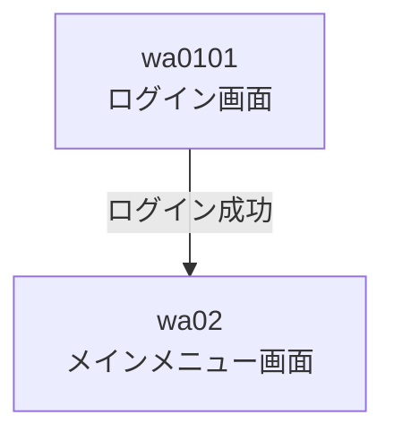

# ログイン画面（wa01）

| 項目 | 内容 |
| --- | --- |
| 機能 ID | wa01 |
| 機能名 | ログイン画面 |
| 種別 | Web 画面 |
| 業務フロー | [a. ログイン業務](../business-requirements/README.md#a-ログイン業務) |
| 関連機能 | [メインメニュー画面（wa02）](./wa02-main-menu.md) |

## 1. 機能概要

ユーザー管理担当者がログイン ID とパスワードを入力し、`user` テーブルの認証情報と照合する。認証に成功した場合は `last_login_datetime` を更新し、メインメニュー（wa02）へ遷移する。失敗時は本画面に留まりエラーを表示する。本業務は画面のみで実施する。

## 2. 機能内画面遷移

機能 ID **wa01** 内の画面。画面 ID は **wa01** + 連番 2 桁とする。

| 画面 ID | 画面名 |
| --- | --- |
| wa0101 | ログイン画面 |

ログイン済みセッションで wa0101 にアクセスした場合は wa02 へ遷移する。

## 3. wa0101_ログイン画面

### 3.1 入出力一覧

種別は **ファイル** および **テーブル** のみとする。本画面では **ファイル** の入出力は行わない。

DB アクセス種別: **○** は該当、**—** は非該当。C = 登録、R = 参照、U = 更新、D = 削除。

| No. | 入出力名 | 種別 | I/O | C | R | U | D | ロック対象 | 備考 |
| ---: | --- | --- | :---: | :---: | :---: | :---: | :---: | :---: | --- |
| 1 | `user` | テーブル | I/O | — | ○ | ○ | — | — | ログインイベント時の照合（R）、成功時に `last_login_datetime` 更新（U） |

### 3.2 画面レイアウト

| 領域 | 内容 |
| --- | --- |
| タイトル | ログイン |
| 入力フォーム | 下記「画面項目一覧」の入力項目（No.1〜2） |
| 操作ボタン | 下記「画面項目一覧」のボタン（No.3） |

### 3.3 画面項目一覧

| No. | 項目種別 | 項目名（画面） | 必須 | 対応 DB 項目 | 入力形式 | 備考 |
| ---: | --- | --- | ---: | --- | --- | --- |
| 1 | 入力項目 | ログイン ID | ○ | `user.login_id` | テキスト | 最大 64 文字 |
| 2 | 入力項目 | パスワード | ○ | （照合のみ平文）→ `user.password_hash` | パスワード | DB には平文を保存しない |
| 3 | ボタン | ログイン | — | — | ボタン | §3.4 イベント「ログイン」。wa02 へ遷移 |

### 3.4 画面イベント一覧

HTTP およびパスは実装時の目安とする。

| No. | イベント名 | イベント概要 | トリガー | 遷移先 | HTTP | パス（例） |
| ---: | --- | --- | --- | --- | --- | --- |
| 1 | 初期表示 | 空のログインフォームを表示する | 画面の GET 要求 | wa0101（自画面） | GET | `/login` |
| 2 | ログイン | 認証を行い、成功時はメインメニューへ進む | ログインボタン押下 | wa02 | POST | `/login` |

### 3.5 画面イベント詳細

#### 3.5.1 初期表示

1. 有効なセッションがあれば wa02 へリダイレクトする。
2. 空のログインフォームを表示する。

#### 3.5.2 ログイン

1. 下表のとおり入力値精査を行う。
2. `login_id` で `user` を参照し、パスワードハッシュを照合する。
3. 認証失敗時は wa0101 を再表示し、エラーメッセージを表示する（入力済みのログイン ID は保持するかは実装時に定義）。
4. 認証成功時は `last_login_datetime` を更新し、セッションを確立して wa02 を表示する。

| 対象 | ルール | エラー時の扱い |
| --- | --- | --- |
| ログイン ID | 必須、長さ ≤ 64 | wa0101 を再表示しエラー表示 |
| パスワード | 必須 | wa0101 を再表示しエラー表示 |

**エラー・例外**

| 状況 | 画面の扱い |
| --- | --- |
| 入力値精査エラー | wa0101 を再表示、項目ごとのメッセージ |
| 認証失敗（ ID 不一致・パスワード不一致） | wa0101 を再表示、「ログインに失敗しました」等のメッセージ |
| DB エラー | wa0101 を再表示（方針はエラーハンドリング設計で定義予定） |