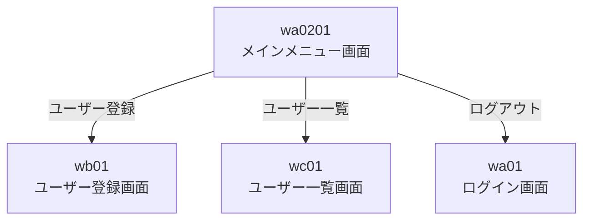

# メインメニュー画面（wa02）

| 項目 | 内容 |
| --- | --- |
| 機能 ID | wa02 |
| 機能名 | メインメニュー画面 |
| 種別 | Web 画面 |
| 業務フロー | [a. ログイン業務](../business-requirements/README.md#a-ログイン業務) |
| 関連機能 | [ログイン画面（wa01）](./wa01-login.md)、[ユーザー登録画面（wb01）](./wb01-user-registration.md)、[ユーザー一覧画面（wc01）](./wc01-user-list.md) |

## 1. 機能概要

ログイン済みのユーザー管理担当者が、各ユーザー管理機能への入口となるメニューを表示する。ユーザー新規登録（wb01）およびユーザー一覧（wc01）へ遷移できる。本画面では DB へのアクセスは行わない。

## 2. 機能内画面遷移

機能 ID **wa02** 内の画面。画面 ID は **wa02** + 連番 2 桁とする。

| 画面 ID | 画面名 |
| --- | --- |
| wa0201 | メインメニュー画面 |

未ログインで wa02 配下の画面にアクセスした場合は wa01 へ遷移する。

## 3. wa0201_メインメニュー画面

### 3.1 入出力一覧

種別は **ファイル** および **テーブル** のみとする。本画面では **テーブル** の入出力は行わない。

| No. | 入出力名 | 種別 | I/O | C | R | U | D | ロック対象 | 備考 |
| ---: | --- | --- | :---: | :---: | :---: | :---: | :---: | :---: | --- |
| 1 | — | — | — | — | — | — | — | — | |

### 3.2 画面レイアウト

| 領域 | 内容 |
| --- | --- |
| タイトル | メインメニュー |
| メニュー | 下記「画面項目一覧」のリンク・ボタン（No.1〜3） |

### 3.3 画面項目一覧

| No. | 項目種別 | 項目名（画面） | 必須 | 対応 DB 項目 | 入力形式 | 備考 |
| ---: | --- | --- | ---: | --- | --- | --- |
| 1 | ボタン | ユーザー登録 | — | — | ボタン | §3.4 イベント「ユーザー登録」。wb01 へ遷移 |
| 2 | ボタン | ユーザー一覧 | — | — | ボタン | §3.4 イベント「ユーザー一覧」。wc01 へ遷移 |
| 3 | ボタン | ログアウト | — | — | ボタン | §3.4 イベント「ログアウト」。wa01 へ遷移 |

### 3.4 画面イベント一覧

HTTP およびパスは実装時の目安とする。

| No. | イベント名 | イベント概要 | トリガー | 遷移先 | HTTP | パス（例） |
| ---: | --- | --- | --- | --- | --- | --- |
| 1 | 初期表示 | メニューを表示する | 画面の GET 要求 | wa0201（自画面） | GET | `/menu` |
| 2 | ユーザー登録 | ユーザー登録機能を開く | ユーザー登録ボタン押下 | wb01 | GET | `/users/registration` |
| 3 | ユーザー一覧 | ユーザー一覧機能を開く | ユーザー一覧ボタン押下 | wc01 | GET | `/users` |
| 4 | ログアウト | セッションを破棄しログイン画面へ戻る | ログアウトボタン押下 | wa01 | POST | `/logout` |

### 3.5 画面イベント詳細

#### 3.5.1 初期表示

1. セッションが無効なら wa01 へリダイレクトする。
2. メニュー画面を表示する。

**エラー・例外**

| 状況 | 画面の扱い |
| --- | --- |
| セッション無効 | wa01 へリダイレクト |

#### 3.5.2 ユーザー登録

wb01（ユーザー登録画面）へ遷移する。

#### 3.5.3 ユーザー一覧

wc01（ユーザー一覧画面）へ遷移する。

#### 3.5.4 ログアウト

1. サーバー側でセッションを無効化する。
2. wa01 を表示する。