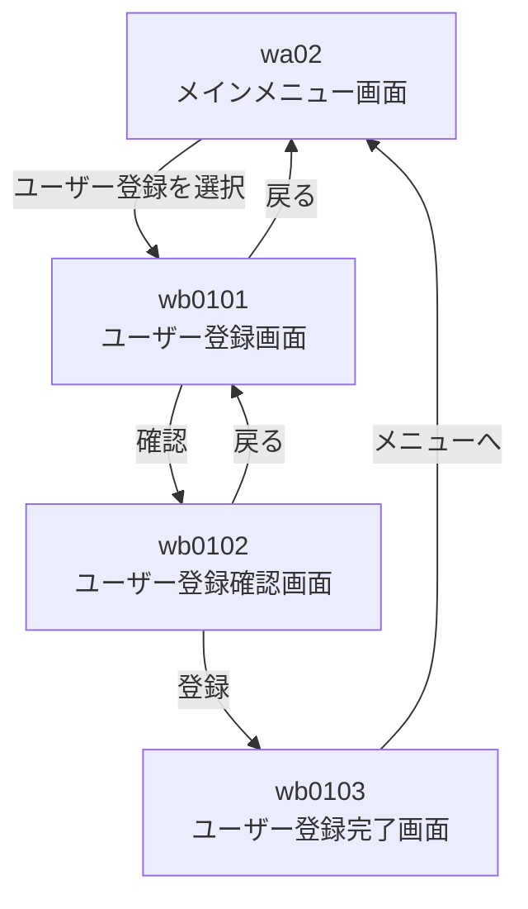

# ユーザー登録画面（wb01）

| 項目 | 内容 |
| --- | --- |
| 機能 ID | wb01 |
| 機能名 | ユーザー登録画面 |
| 種別 | Web 画面 |
| 業務フロー | [b. ユーザー新規登録業務](../business-requirements/README.md#b-ユーザー新規登録業務) |
| 関連機能 | [メインメニュー画面（wa02）](./wa02-main-menu.md)、[ユーザー登録 API（ab01）](./ab01-user-registration-api.md) |

## 1. 機能概要

ログイン済みのユーザー管理担当者が、メインメニューから本画面を開き、新規ユーザーの属性を入力して登録する。登録内容は `user` テーブルに永続化する（パスワードはハッシュ化して `password_hash` に保存する）。同一の登録処理は [ab01](./ab01-user-registration-api.md) の REST API からも実行できるが、本設計書は画面経由のみを対象とする。

## 2. 機能内画面遷移

機能 ID **wb01** 内の画面。画面 ID は **wb01** + 連番 2 桁とする。

| 画面 ID | 画面名 |
| --- | --- |
| wb0101 | ユーザー登録画面 |
| wb0102 | ユーザー登録確認画面 |
| wb0103 | ユーザー登録完了画面 |

未ログインで wb01 配下の画面にアクセスした場合は wa01 へ遷移する。

## 3. wb0101_ユーザー登録画面

### 3.1 入出力一覧

種別は **ファイル** および **テーブル** のみとする。本画面では **ファイル** の入出力は行わない。

DB アクセス種別: **○** は該当、**—** は非該当。C = 登録、R = 参照、U = 更新、D = 削除。

| No. | 入出力名 | 種別 | I/O | C | R | U | D | ロック対象 | 備考 |
| ---: | --- | --- | :---: | :---: | :---: | :---: | :---: | :---: | --- |
| 1 | `department` | テーブル | I | — | ○ | — | — | — | 初期表示時の部門一覧参照 |
| 2 | `user` | テーブル | I | — | ○ | — | — | — | 確認時の `login_id` 重複参照 |

### 3.2 画面レイアウト

| 領域 | 内容 |
| --- | --- |
| タイトル | ユーザー登録 |
| 入力フォーム | 下記「画面項目一覧」の入力項目（No.1〜5） |
| 操作ボタン | 下記「画面項目一覧」のボタン（No.6〜7） |

### 3.3 画面項目一覧

| No. | 項目種別 | 項目名（画面） | 必須 | 対応 DB 項目 | 入力形式 | 備考 |
| ---: | --- | --- | ---: | --- | --- | --- |
| 1 | 入力項目 | 部門 | ○ | `user.department_id` | プルダウン（`department` 一覧） | `department_code` / `department_name` を表示 |
| 2 | 入力項目 | ログイン ID | ○ | `user.login_id` | テキスト | 最大 64 文字、重複不可（UK） |
| 3 | 入力項目 | パスワード | ○ | （登録時のみ平文）→ `user.password_hash` | パスワード | |
| 4 | 入力項目 | パスワード確認 | ○ | — | パスワード | DB には保存しない。パスワードと一致すること |
| 5 | 入力項目 | ユーザー名 | ○ | `user.user_name` | テキスト | 最大 128 文字 |
| 6 | ボタン | 確認 | — | — | ボタン | §3.4 イベント「確認」。wb0102 へ遷移 |
| 7 | ボタン | 戻る | — | — | ボタン | §3.4 イベント「戻る」。wa02 へ遷移 |

`user_id`、`last_login_datetime`、`create_datetime`、`update_datetime` は入力しない（サーバー側で採番・設定）。`authority_code` は **`GENERAL` 固定** とし、画面項目には含めない。

### 3.4 画面イベント一覧

HTTP およびパスは実装時の目安とする。

| No. | イベント名 | イベント概要 | トリガー | 遷移先 | HTTP | パス（例） |
| ---: | --- | --- | --- | --- | --- | --- |
| 1 | 初期表示 | 部門一覧を取得し、空の登録フォームを表示する | 画面の GET 要求 | wb0101（自画面） | GET | `/users/registration` |
| 2 | 確認 | 入力値を精査し、OK なら確認画面へ進む | 確認ボタン押下 | wb0102 | POST | `/users/registration` |
| 3 | 戻る | 入力を破棄してメインメニューへ戻る | 戻るボタン押下 | wa02 | GET | `/menu` |

### 3.5 画面イベント詳細

#### 3.5.1 初期表示

1. セッションが無効なら wa01 へリダイレクトする。
2. `department` から部門一覧を取得し、部門プルダウンにセットする。
3. 空の登録フォームを表示する。

**エラー・例外**

| 状況 | 画面の扱い |
| --- | --- |
| セッション無効 | wa01 へリダイレクト |

#### 3.5.2 確認

1. 下表のとおり入力値精査を行う。
2. 精査エラー時は wb0101 を再表示し、エラーメッセージと入力済み値を保持する。
3. 精査 OK 時は入力内容をセッション等に保持し、wb0102 を表示する。

| 対象 | ルール | エラー時の扱い |
| --- | --- | --- |
| 部門 | 必須、選択値が `department` に存在すること | wb0101 を再表示しエラー表示 |
| ログイン ID | 必須、長さ ≤ 64、未登録（UK 違反なし） | wb0101 を再表示しエラー表示 |
| パスワード | 必須、ポリシー（最小長等）は実装時に定義 | wb0101 を再表示しエラー表示 |
| パスワード確認 | 必須、パスワードと一致すること | wb0101 を再表示しエラー表示 |
| ユーザー名 | 必須、長さ ≤ 128 | wb0101 を再表示しエラー表示 |

**エラー・例外**

| 状況 | 画面の扱い |
| --- | --- |
| バリデーションエラー | wb0101 を再表示、項目ごとのメッセージ |
| ログイン ID 重複 | wb0101 を再表示、「既に登録済み」等のメッセージ |

#### 3.5.3 戻る

メインメニュー（wa02）へ遷移する。未保存の入力は破棄する。

## 4. wb0102_ユーザー登録確認画面

### 4.1 入出力一覧

種別は **ファイル** および **テーブル** のみとする。本画面では **ファイル** の入出力は行わない。

DB アクセス種別: **○** は該当、**—** は非該当。C = 登録、R = 参照、U = 更新、D = 削除。

| No. | 入出力名 | 種別 | I/O | C | R | U | D | ロック対象 | 備考 |
| ---: | --- | --- | :---: | :---: | :---: | :---: | :---: | :---: | --- |
| 1 | `user` | テーブル | O | ○ | — | — | — | — | 登録イベント時の INSERT（`password_hash` はハッシュ格納） |

### 4.2 画面レイアウト

| 領域 | 内容 |
| --- | --- |
| タイトル | ユーザー登録確認 |
| 確認表示 | 下記「画面項目一覧」の表示項目（No.1〜5） |
| 操作ボタン | 下記「画面項目一覧」のボタン（No.6〜7） |

### 4.3 画面項目一覧

| No. | 項目種別 | 項目名（画面） | 必須 | 対応 DB 項目 | 入力形式 | 備考 |
| ---: | --- | --- | ---: | --- | --- | --- |
| 1 | 表示項目 | 部門 | — | `user.department_id` | 表示 | 部門名を表示 |
| 2 | 表示項目 | ログイン ID | — | `user.login_id` | 表示 | |
| 3 | 表示項目 | パスワード | — | `user.password_hash` | 表示 | マスク表示（値は表示しない） |
| 4 | 表示項目 | ユーザー名 | — | `user.user_name` | 表示 | |
| 5 | 表示項目 | 権限コード | — | `user.authority_code` | 表示 | 固定値 `GENERAL` を表示 |
| 6 | ボタン | 登録 | — | — | ボタン | §4.4 イベント「登録」。wb0103 へ遷移 |
| 7 | ボタン | 戻る | — | — | ボタン | §4.4 イベント「戻る」。wb0101 へ遷移 |

### 4.4 画面イベント一覧

HTTP およびパスは実装時の目安とする。

| No. | イベント名 | イベント概要 | トリガー | 遷移先 | HTTP | パス（例） |
| ---: | --- | --- | --- | --- | --- | --- |
| 1 | 初期表示 | 保持した入力内容を確認用に表示する | 画面の GET 要求 | wb0102（自画面） | GET | `/users/registration/confirm` |
| 2 | 登録 | 保持内容で `user` に INSERT し、完了画面へ進む | 登録ボタン押下 | wb0103 | POST | `/users/registration/confirm` |
| 3 | 戻る | 入力画面を入力内容付きで再表示する | 戻るボタン押下 | wb0101 | GET | `/users/registration` |

### 4.5 画面イベント詳細

#### 4.5.1 初期表示

1. セッションが無効なら wa01 へリダイレクトする。
2. wb0101 で保持した入力内容を読み取り、確認画面を表示する。

**エラー・例外**

| 状況 | 画面の扱い |
| --- | --- |
| セッション無効 | wa01 へリダイレクト |
| 保持データなし | wb0101 へ遷移 |

#### 4.5.2 登録

1. 保持した内容で `user` への INSERT を行う（パスワードはハッシュ化、`authority_code` は `GENERAL` 固定）。
2. 成功時は wb0103 を表示する。

**エラー・例外**

| 状況 | 画面の扱い |
| --- | --- |
| DB エラー | wb0102 または wb0101 を再表示（方針はエラーハンドリング設計で定義予定） |

#### 4.5.3 戻る

wb0101 を入力内容付きで再表示する。

## 5. wb0103_ユーザー登録完了画面

### 5.1 入出力一覧

種別は **ファイル** および **テーブル** のみとする。本画面では **ファイル** の入出力は行わない。

DB アクセス種別: **○** は該当、**—** は非該当。C = 登録、R = 参照、U = 更新、D = 削除。

| No. | 入出力名 | 種別 | I/O | C | R | U | D | ロック対象 | 備考 |
| ---: | --- | --- | :---: | :---: | :---: | :---: | :---: | :---: | --- |
| 1 | — | — | — | — | — | — | — | — | |

### 5.2 画面レイアウト

| 領域 | 内容 |
| --- | --- |
| タイトル | ユーザー登録完了 |
| メッセージ | 下記「画面項目一覧」の表示項目（No.1） |
| 操作ボタン | 下記「画面項目一覧」のボタン（No.2） |

### 5.3 画面項目一覧

| No. | 項目種別 | 項目名（画面） | 必須 | 対応 DB 項目 | 入力形式 | 備考 |
| ---: | --- | --- | ---: | --- | --- | --- |
| 1 | 表示項目 | 登録完了メッセージ | — | — | 表示 | 登録完了の旨 |
| 2 | ボタン | メニューへ | — | — | ボタン | §5.4 イベント「メニューへ」。wa02 へ遷移 |

### 5.4 画面イベント一覧

HTTP およびパスは実装時の目安とする。

| No. | イベント名 | イベント概要 | トリガー | 遷移先 | HTTP | パス（例） |
| ---: | --- | --- | --- | --- | --- | --- |
| 1 | 初期表示 | 登録完了メッセージを表示する | 画面の GET 要求 | wb0103（自画面） | GET | `/users/registration/complete` |
| 2 | メニューへ | メインメニューへ遷移する | メニューへボタン押下 | wa02 | GET | `/menu` |

### 5.5 画面イベント詳細

#### 5.5.1 初期表示

1. セッションが無効なら wa01 へリダイレクトする。
2. 登録完了メッセージを表示する。

**エラー・例外**

| 状況 | 画面の扱い |
| --- | --- |
| セッション無効 | wa01 へリダイレクト |

#### 5.5.2 メニューへ

メインメニュー（wa02）へ遷移する。