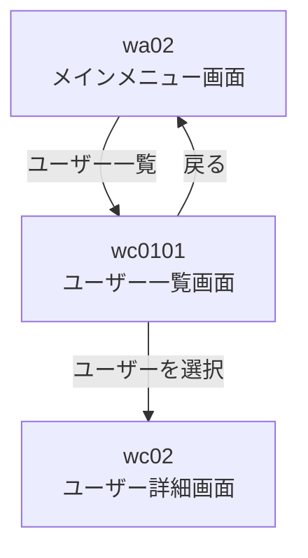

# ユーザー一覧画面（wc01）

| 項目 | 内容 |
| --- | --- |
| 機能 ID | wc01 |
| 機能名 | ユーザー一覧画面 |
| 種別 | Web 画面 |
| 業務フロー | [c. ユーザー確認業務](../business-requirements/README.md#c-ユーザー確認業務) |
| 関連機能 | [メインメニュー画面（wa02）](./wa02-main-menu.md)、[ユーザー詳細画面（wc02）](./wc02-user-detail.md) |

## 1. 機能概要

ログイン済みのユーザー管理担当者が、登録済みユーザーの一覧を画面で確認する。一覧からユーザーを選択し、詳細画面（wc02）へ遷移する。一覧の取得は画面経由のみとし、API 経由の取得は [ac01](./ac01-user-get-api.md) を参照する。

## 2. 機能内画面遷移

機能 ID **wc01** 内の画面。画面 ID は **wc01** + 連番 2 桁とする。

| 画面 ID | 画面名 |
| --- | --- |
| wc0101 | ユーザー一覧画面 |

未ログインで wc01 配下の画面にアクセスした場合は wa01 へ遷移する。

## 3. wc0101_ユーザー一覧画面

### 3.1 入出力一覧

種別は **ファイル** および **テーブル** のみとする。本画面では **ファイル** の入出力は行わない。

DB アクセス種別: **○** は該当、**—** は非該当。C = 登録、R = 参照、U = 更新、D = 削除。

| No. | 入出力名 | 種別 | I/O | C | R | U | D | ロック対象 | 備考 |
| ---: | --- | --- | :---: | :---: | :---: | :---: | :---: | :---: | --- |
| 1 | `user` | テーブル | I | — | ○ | — | — | — | 一覧取得。`department` と結合して部門名を表示 |
| 2 | `department` | テーブル | I | — | ○ | — | — | — | 部門名表示用 |

### 3.2 画面レイアウト

| 領域 | 内容 |
| --- | --- |
| タイトル | ユーザー一覧 |
| 一覧表 | 下記「画面項目一覧」の表示項目（No.1〜5）を行単位に表示 |
| 操作 | 下記「画面項目一覧」のボタン・リンク（No.6〜7） |

### 3.3 画面項目一覧

| No. | 項目種別 | 項目名（画面） | 必須 | 対応 DB 項目 | 入力形式 | 備考 |
| ---: | --- | --- | ---: | --- | --- | --- |
| 1 | 表示項目 | ログイン ID | — | `user.login_id` | 表示 | 一覧の列 |
| 2 | 表示項目 | ユーザー名 | — | `user.user_name` | 表示 | 一覧の列 |
| 3 | 表示項目 | 部門名 | — | `department.department_name` | 表示 | `user.department_id` 経由 |
| 4 | 表示項目 | 権限コード | — | `user.authority_code` | 表示 | 一覧の列 |
| 5 | 表示項目 | 最終ログイン日時 | — | `user.last_login_datetime` | 表示 | 未ログインは空表示 |
| 6 | ボタン | 詳細へ | — | `user.user_id` | リンク／ボタン | §3.4 イベント「ユーザー選択」。wc02 へ遷移 |
| 7 | ボタン | 戻る | — | — | ボタン | §3.4 イベント「戻る」。wa02 へ遷移 |

### 3.4 画面イベント一覧

HTTP およびパスは実装時の目安とする。

| No. | イベント名 | イベント概要 | トリガー | 遷移先 | HTTP | パス（例） |
| ---: | --- | --- | --- | --- | --- | --- |
| 1 | 初期表示 | ユーザー一覧を取得して表示する | 画面の GET 要求 | wc0101（自画面） | GET | `/users` |
| 2 | ユーザー選択 | 選択したユーザーの詳細画面を開く | 詳細へ押下 | wc02 | GET | `/users/{userId}` |
| 3 | 戻る | メインメニューへ戻る | 戻るボタン押下 | wa02 | GET | `/menu` |

### 3.5 画面イベント詳細

#### 3.5.1 初期表示

1. セッションが無効なら wa01 へリダイレクトする。
2. `user` と `department` から一覧データを取得し、表形式で表示する。

**エラー・例外**

| 状況 | 画面の扱い |
| --- | --- |
| セッション無効 | wa01 へリダイレクト |
| DB エラー | wc0101 を再表示（方針はエラーハンドリング設計で定義予定） |

#### 3.5.2 ユーザー選択

指定した `user_id` の wc02（ユーザー詳細画面）へ遷移する。

#### 3.5.3 戻る

メインメニュー（wa02）へ遷移する。