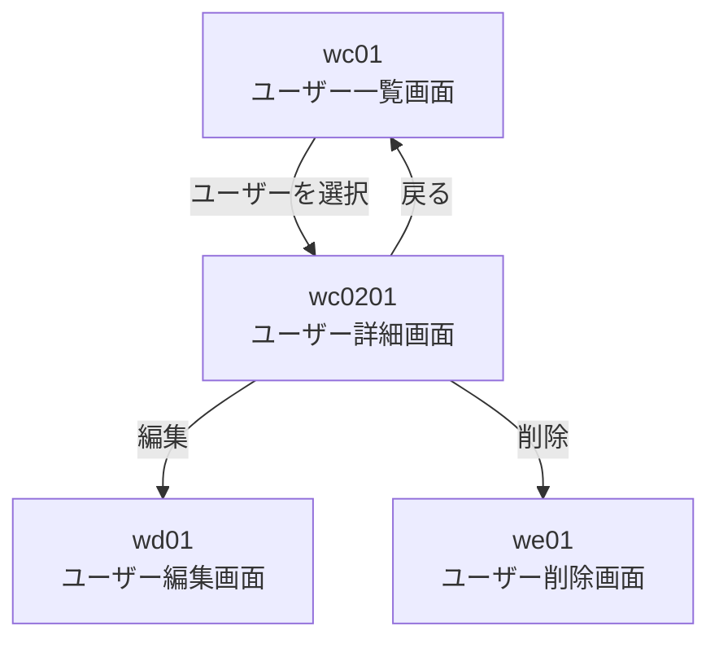

# ユーザー詳細画面（wc02）

| 項目 | 内容 |
| --- | --- |
| 機能 ID | wc02 |
| 機能名 | ユーザー詳細画面 |
| 種別 | Web 画面 |
| 業務フロー | [c. ユーザー確認業務](../business-requirements/README.md#c-ユーザー確認業務) |
| 関連機能 | [ユーザー一覧画面（wc01）](./wc01-user-list.md)、[ユーザー編集画面（wd01）](./wd01-user-edit.md)、[ユーザー削除画面（we01）](./we01-user-delete.md)、[ユーザー取得 API（ac01）](./ac01-user-get-api.md) |

## 1. 機能概要

ログイン済みのユーザー管理担当者が、指定ユーザーの属性を画面で確認する。一覧（wc01）から遷移する。編集（wd01）・削除（we01）へ進める。同一情報の API 取得は [ac01](./ac01-user-get-api.md) で定義する。

## 2. 機能内画面遷移

機能 ID **wc02** 内の画面。画面 ID は **wc02** + 連番 2 桁とする。

| 画面 ID | 画面名 |
| --- | --- |
| wc0201 | ユーザー詳細画面 |

未ログインで wc02 配下の画面にアクセスした場合は wa01 へ遷移する。

## 3. wc0201_ユーザー詳細画面

### 3.1 入出力一覧

種別は **ファイル** および **テーブル** のみとする。本画面では **ファイル** の入出力は行わない。

DB アクセス種別: **○** は該当、**—** は非該当。C = 登録、R = 参照、U = 更新、D = 削除。

| No. | 入出力名 | 種別 | I/O | C | R | U | D | ロック対象 | 備考 |
| ---: | --- | --- | :---: | :---: | :---: | :---: | :---: | :---: | --- |
| 1 | `user` | テーブル | I | — | ○ | — | — | — | 指定 `user_id` の詳細参照 |
| 2 | `department` | テーブル | I | — | ○ | — | — | — | 部門名表示用 |

### 3.2 画面レイアウト

| 領域 | 内容 |
| --- | --- |
| タイトル | ユーザー詳細 |
| 詳細表示 | 下記「画面項目一覧」の表示項目（No.1〜7） |
| 操作ボタン | 下記「画面項目一覧」のボタン（No.8〜10） |

### 3.3 画面項目一覧

| No. | 項目種別 | 項目名（画面） | 必須 | 対応 DB 項目 | 入力形式 | 備考 |
| ---: | --- | --- | ---: | --- | --- | --- |
| 1 | 表示項目 | ユーザー ID | — | `user.user_id` | 表示 | |
| 2 | 表示項目 | ログイン ID | — | `user.login_id` | 表示 | |
| 3 | 表示項目 | ユーザー名 | — | `user.user_name` | 表示 | |
| 4 | 表示項目 | 部門名 | — | `department.department_name` | 表示 | |
| 5 | 表示項目 | 権限コード | — | `user.authority_code` | 表示 | |
| 6 | 表示項目 | 最終ログイン日時 | — | `user.last_login_datetime` | 表示 | |
| 7 | 表示項目 | 登録日時／更新日時 | — | `user.create_datetime` / `user.update_datetime` | 表示 | 表示形式は実装時に定義 |
| 8 | ボタン | 編集 | — | — | ボタン | §3.4 イベント「編集」。wd01 へ遷移 |
| 9 | ボタン | 削除 | — | — | ボタン | §3.4 イベント「削除」。we01 へ遷移 |
| 10 | ボタン | 戻る | — | — | ボタン | §3.4 イベント「戻る」。wc01 へ遷移 |

パスワードハッシュは画面に表示しない。

### 3.4 画面イベント一覧

HTTP およびパスは実装時の目安とする。

| No. | イベント名 | イベント概要 | トリガー | 遷移先 | HTTP | パス（例） |
| ---: | --- | --- | --- | --- | --- | --- |
| 1 | 初期表示 | 指定ユーザーの詳細を表示する | 画面の GET 要求 | wc0201（自画面） | GET | `/users/{userId}` |
| 2 | 編集 | 編集画面を開く | 編集ボタン押下 | wd01 | GET | `/users/{userId}/edit` |
| 3 | 削除 | 削除画面を開く | 削除ボタン押下 | we01 | GET | `/users/{userId}/delete` |
| 4 | 戻る | 一覧画面へ戻る | 戻るボタン押下 | wc01 | GET | `/users` |

### 3.5 画面イベント詳細

#### 3.5.1 初期表示

1. セッションが無効なら wa01 へリダイレクトする。
2. URL の `user_id` に該当する `user` を取得し、存在しなければ wc01 へ遷移する。
3. 詳細を表示する。

**エラー・例外**

| 状況 | 画面の扱い |
| --- | --- |
| セッション無効 | wa01 へリダイレクト |
| ユーザー不存在 | wc01 へ遷移 |
| DB エラー | wc0201 を再表示（方針はエラーハンドリング設計で定義予定） |

#### 3.5.2 編集

wd01（ユーザー編集画面）へ遷移する。

#### 3.5.3 削除

we01（ユーザー削除画面）へ遷移する。

#### 3.5.4 戻る

wc01（ユーザー一覧画面）へ遷移する。