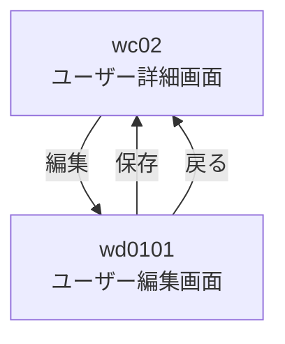

# ユーザー編集画面（wd01）

| 項目 | 内容 |
| --- | --- |
| 機能 ID | wd01 |
| 機能名 | ユーザー編集画面 |
| 種別 | Web 画面 |
| 業務フロー | [d. ユーザー編集業務](../business-requirements/README.md#d-ユーザー編集業務) |
| 関連機能 | [ユーザー詳細画面（wc02）](./wc02-user-detail.md)、[ユーザー更新 API（ad01）](./ad01-user-update-api.md) |

## 1. 機能概要

ログイン済みのユーザー管理担当者が、wc02 で確認したユーザーの属性を変更する。保存時に `user` を UPDATE する。パスワードを空のままにした場合は変更しない等のルールは実装時に定義する。同一の更新処理は [ad01](./ad01-user-update-api.md) からも実行できるが、本設計書は画面経由のみを対象とする。

## 2. 機能内画面遷移

機能 ID **wd01** 内の画面。画面 ID は **wd01** + 連番 2 桁とする。

| 画面 ID | 画面名 |
| --- | --- |
| wd0101 | ユーザー編集画面 |

未ログインで wd01 配下の画面にアクセスした場合は wa01 へ遷移する。

## 3. wd0101_ユーザー編集画面

### 3.1 入出力一覧

種別は **ファイル** および **テーブル** のみとする。本画面では **ファイル** の入出力は行わない。

DB アクセス種別: **○** は該当、**—** は非該当。C = 登録、R = 参照、U = 更新、D = 削除。

| No. | 入出力名 | 種別 | I/O | C | R | U | D | ロック対象 | 備考 |
| ---: | --- | --- | :---: | :---: | :---: | :---: | :---: | :---: | --- |
| 1 | `department` | テーブル | I | — | ○ | — | — | — | 部門プルダウン用 |
| 2 | `user` | テーブル | I | — | ○ | — | — | — | 初期表示（R） |
| 3 | `user` | テーブル | O | — | — | ○ | — | — | 保存（U） |

### 3.2 画面レイアウト

| 領域 | 内容 |
| --- | --- |
| タイトル | ユーザー編集 |
| 入力フォーム | 下記「画面項目一覧」の入力項目・表示項目（No.1〜6） |
| 操作ボタン | 下記「画面項目一覧」のボタン（No.7〜8） |

### 3.3 画面項目一覧

| No. | 項目種別 | 項目名（画面） | 必須 | 対応 DB 項目 | 入力形式 | 備考 |
| ---: | --- | --- | ---: | --- | --- | --- |
| 1 | 表示項目 | ログイン ID | — | `user.login_id` | 表示 | 変更不可 |
| 2 | 入力項目 | 部門 | ○ | `user.department_id` | プルダウン | `department` 一覧 |
| 3 | 入力項目 | ユーザー名 | ○ | `user.user_name` | テキスト | 最大 128 文字 |
| 4 | 入力項目 | パスワード | — | → `user.password_hash` | パスワード | 未入力なら変更しない |
| 5 | 入力項目 | 権限コード | ○ | `user.authority_code` | プルダウン／テキスト | 例: `ADMIN` / `GENERAL` |
| 6 | 表示項目 | 最終ログイン日時 | — | `user.last_login_datetime` | 表示 | 読取専用 |
| 7 | ボタン | 保存 | — | — | ボタン | §3.4 イベント「保存」。wc02 へ遷移 |
| 8 | ボタン | 戻る | — | — | ボタン | §3.4 イベント「戻る」。wc02 へ遷移 |

### 3.4 画面イベント一覧

HTTP およびパスは実装時の目安とする。

| No. | イベント名 | イベント概要 | トリガー | 遷移先 | HTTP | パス（例） |
| ---: | --- | --- | --- | --- | --- | --- |
| 1 | 初期表示 | 対象ユーザーの現行値をフォームに表示する | 画面の GET 要求 | wd0101（自画面） | GET | `/users/{userId}/edit` |
| 2 | 保存 | 入力値を精査し、OK なら UPDATE して詳細へ戻る | 保存ボタン押下 | wc02 | POST | `/users/{userId}/edit` |
| 3 | 戻る | 変更を破棄して詳細画面へ戻る | 戻るボタン押下 | wc02 | GET | `/users/{userId}` |

### 3.5 画面イベント詳細

#### 3.5.1 初期表示

1. セッションが無効なら wa01 へリダイレクトする。
2. `department` 一覧と対象 `user` を取得し、フォームにセットする。

**エラー・例外**

| 状況 | 画面の扱い |
| --- | --- |
| セッション無効 | wa01 へリダイレクト |
| ユーザー不存在 | wc01 へ遷移 |
| DB エラー | wd0101 を再表示（方針はエラーハンドリング設計で定義予定） |

#### 3.5.2 保存

1. 下表のとおり入力値精査を行う。
2. 精査エラー時は wd0101 を再表示し、エラーメッセージと入力済み値を保持する。
3. 精査 OK 時は `user` を UPDATE し、wc0201 を表示する（保存成功メッセージは実装時に定義）。

| 対象 | ルール | エラー時の扱い |
| --- | --- | --- |
| 部門 | 必須、選択値が `department` に存在すること | wd0101 を再表示しエラー表示 |
| ユーザー名 | 必須、長さ ≤ 128 | wd0101 を再表示しエラー表示 |
| パスワード | 入力時のみポリシーに適合 | wd0101 を再表示しエラー表示 |
| 権限コード | 必須、許容値のみ | wd0101 を再表示しエラー表示 |

**エラー・例外**

| 状況 | 画面の扱い |
| --- | --- |
| バリデーションエラー | wd0101 を再表示、項目ごとのメッセージ |
| DB エラー | wd0101 を再表示（方針はエラーハンドリング設計で定義予定） |

#### 3.5.3 戻る

変更を保存せず wc02（同一 `user_id`）へ遷移する。