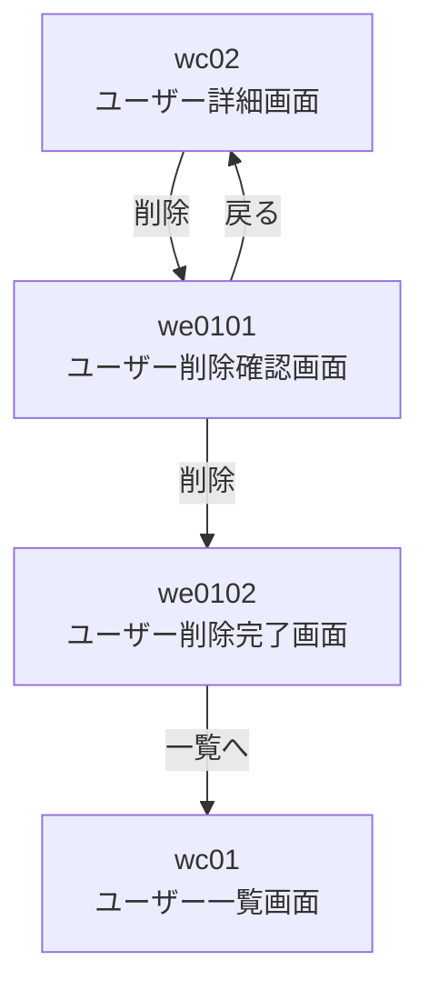

# ユーザー削除画面（we01）

| 項目 | 内容 |
| --- | --- |
| 機能 ID | we01 |
| 機能名 | ユーザー削除画面 |
| 種別 | Web 画面 |
| 業務フロー | [e. ユーザー削除業務](../business-requirements/README.md#e-ユーザー削除業務) |
| 関連機能 | [ユーザー詳細画面（wc02）](./wc02-user-detail.md)、[ユーザー削除 API（ae01）](./ae01-user-delete-api.md) |

## 1. 機能概要

ログイン済みのユーザー管理担当者が、wc02 から遷移し、対象ユーザーの削除を確認の上で実行する。成功時は `user` から DELETE し、一覧へ戻る。API 経由の削除は [ae01](./ae01-user-delete-api.md) を参照する。

## 2. 機能内画面遷移

機能 ID **we01** 内の画面。画面 ID は **we01** + 連番 2 桁とする。

| 画面 ID | 画面名 |
| --- | --- |
| we0101 | ユーザー削除確認画面 |
| we0102 | ユーザー削除完了画面 |

未ログインで we01 配下の画面にアクセスした場合は wa01 へ遷移する。

## 3. we0101_ユーザー削除確認画面

### 3.1 入出力一覧

種別は **ファイル** および **テーブル** のみとする。本画面では **ファイル** の入出力は行わない。

DB アクセス種別: **○** は該当、**—** は非該当。C = 登録、R = 参照、U = 更新、D = 削除。

| No. | 入出力名 | 種別 | I/O | C | R | U | D | ロック対象 | 備考 |
| ---: | --- | --- | :---: | :---: | :---: | :---: | :---: | :---: | --- |
| 1 | `user` | テーブル | I | — | ○ | — | — | — | 確認表示（R） |
| 2 | `user` | テーブル | O | — | — | — | ○ | — | 削除実行（D） |
| 3 | `department` | テーブル | I | — | ○ | — | — | — | 表示用部門名 |

### 3.2 画面レイアウト

| 領域 | 内容 |
| --- | --- |
| タイトル | ユーザー削除確認 |
| 確認表示 | 削除対象ユーザーの識別情報（No.1〜4） |
| 操作ボタン | 下記「画面項目一覧」のボタン（No.5〜6） |

### 3.3 画面項目一覧

| No. | 項目種別 | 項目名（画面） | 必須 | 対応 DB 項目 | 入力形式 | 備考 |
| ---: | --- | --- | ---: | --- | --- | --- |
| 1 | 表示項目 | ログイン ID | — | `user.login_id` | 表示 | |
| 2 | 表示項目 | ユーザー名 | — | `user.user_name` | 表示 | |
| 3 | 表示項目 | 部門名 | — | `department.department_name` | 表示 | |
| 4 | 表示項目 | 確認メッセージ | — | — | 表示 | 削除の注意喚起 |
| 5 | ボタン | 削除 | — | — | ボタン | §3.4 イベント「削除」。we0102 へ遷移 |
| 6 | ボタン | 戻る | — | — | ボタン | §3.4 イベント「戻る」。wc02 へ遷移 |

### 3.4 画面イベント一覧

HTTP およびパスは実装時の目安とする。

| No. | イベント名 | イベント概要 | トリガー | 遷移先 | HTTP | パス（例） |
| ---: | --- | --- | --- | --- | --- | --- |
| 1 | 初期表示 | 削除対象ユーザーの情報を表示する | 画面の GET 要求 | we0101（自画面） | GET | `/users/{userId}/delete` |
| 2 | 削除 | 対象ユーザーを DELETE し完了画面へ進む | 削除ボタン押下 | we0102 | POST | `/users/{userId}/delete` |
| 3 | 戻る | 詳細画面へ戻る | 戻るボタン押下 | wc02 | GET | `/users/{userId}` |

### 3.5 画面イベント詳細

#### 3.5.1 初期表示

1. セッションが無効なら wa01 へリダイレクトする。
2. 対象 `user` を取得し、確認画面を表示する。

**エラー・例外**

| 状況 | 画面の扱い |
| --- | --- |
| セッション無効 | wa01 へリダイレクト |
| ユーザー不存在 | wc01 へ遷移 |
| DB エラー | we0101 を再表示（方針はエラーハンドリング設計で定義予定） |

#### 3.5.2 削除

1. 対象 `user` を DELETE する（自己削除・最後の管理者削除の禁止等は実装時に定義）。
2. 成功時は we0102 を表示する。

**エラー・例外**

| 状況 | 画面の扱い |
| --- | --- |
| DB エラー | we0101 または wc02 を再表示（方針はエラーハンドリング設計で定義予定） |
| 削除不可（業務ルール違反） | we0101 を再表示しメッセージ表示 |

#### 3.5.3 戻る

wc02 へ遷移する。削除は行わない。

## 4. we0102_ユーザー削除完了画面

### 4.1 入出力一覧

種別は **ファイル** および **テーブル** のみとする。本画面では **テーブル** の入出力は行わない。

| No. | 入出力名 | 種別 | I/O | C | R | U | D | ロック対象 | 備考 |
| ---: | --- | --- | :---: | :---: | :---: | :---: | :---: | :---: | --- |
| 1 | — | — | — | — | — | — | — | — | |

### 4.2 画面レイアウト

| 領域 | 内容 |
| --- | --- |
| タイトル | ユーザー削除完了 |
| メッセージ | 下記「画面項目一覧」の表示項目（No.1） |
| 操作ボタン | 下記「画面項目一覧」のボタン（No.2） |

### 4.3 画面項目一覧

| No. | 項目種別 | 項目名（画面） | 必須 | 対応 DB 項目 | 入力形式 | 備考 |
| ---: | --- | --- | ---: | --- | --- | --- |
| 1 | 表示項目 | 削除完了メッセージ | — | — | 表示 | 削除完了の旨 |
| 2 | ボタン | 一覧へ | — | — | ボタン | §4.4 イベント「一覧へ」。wc01 へ遷移 |

### 4.4 画面イベント一覧

HTTP およびパスは実装時の目安とする。

| No. | イベント名 | イベント概要 | トリガー | 遷移先 | HTTP | パス（例） |
| ---: | --- | --- | --- | --- | --- | --- |
| 1 | 初期表示 | 削除完了メッセージを表示する | 画面の GET 要求 | we0102（自画面） | GET | `/users/{userId}/delete/complete` |
| 2 | 一覧へ | ユーザー一覧へ遷移する | 一覧へボタン押下 | wc01 | GET | `/users` |

### 4.5 画面イベント詳細

#### 4.5.1 初期表示

1. セッションが無効なら wa01 へリダイレクトする。
2. 削除完了メッセージを表示する（削除直後以外の直接アクセスは wc01 へ遷移する等、実装時に定義）。

**エラー・例外**

| 状況 | 画面の扱い |
| --- | --- |
| セッション無効 | wa01 へリダイレクト |
| 不正な直接アクセス | wc01 へ遷移 |

#### 4.5.2 一覧へ

wc01（ユーザー一覧画面）へ遷移する。