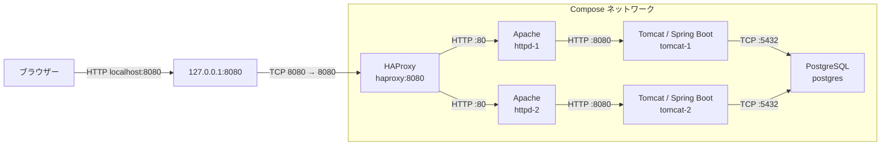
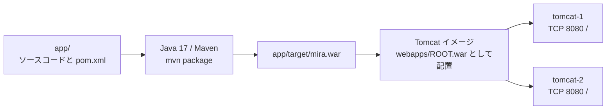
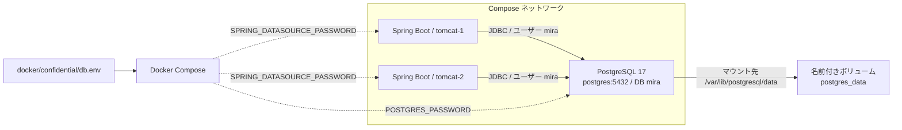
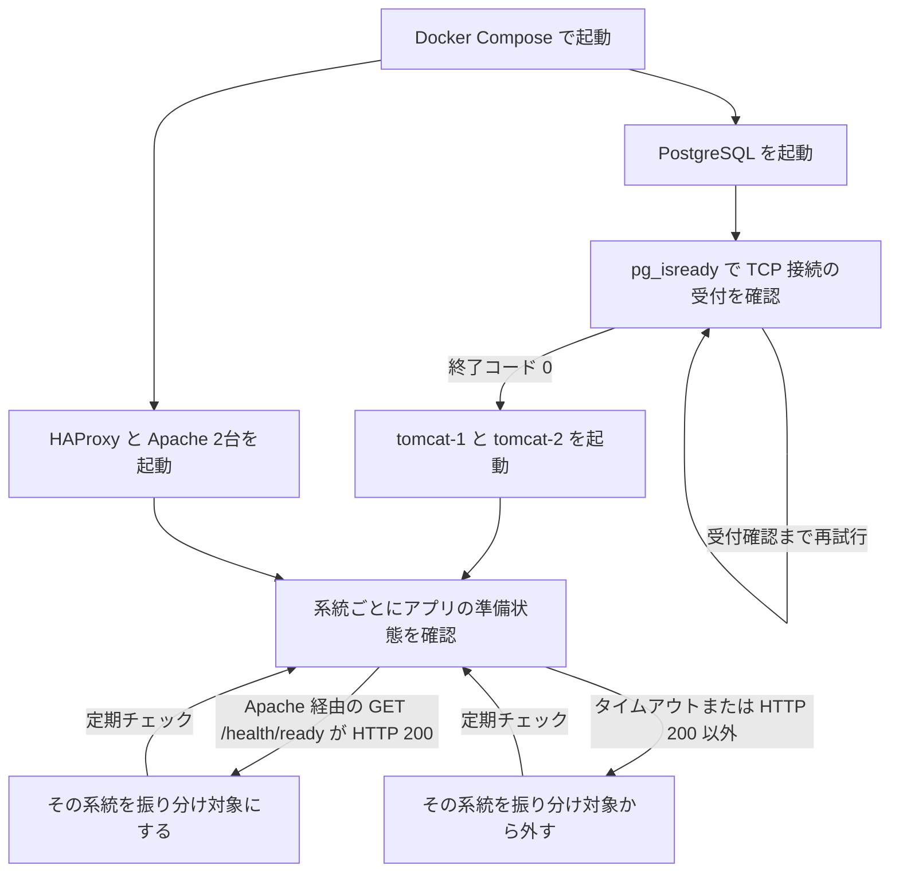
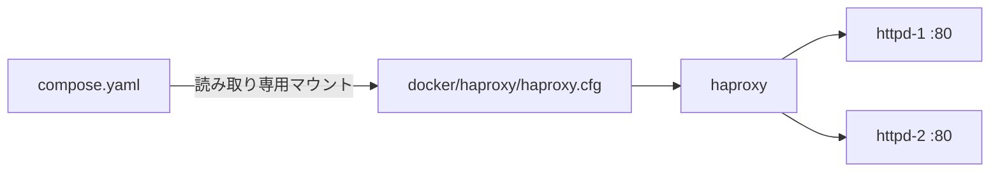
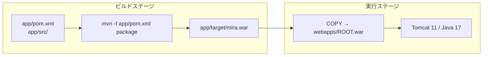
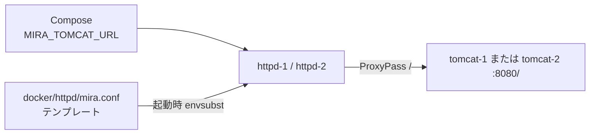

# MIRA の Docker 開発環境

Docker Compose で HAProxy、Apache HTTP Server、Apache Tomcat（Spring Boot アプリを配置）、PostgreSQL を起動し、MIRA のローカル開発環境を構築する。

## 実行環境の想定

| 区分 | 想定 |
| --- | --- |
| コンテナ内（実行 OS） | **Linux**（No.2 の Docker 公式イメージ。HAProxy・Apache・Tomcat・PostgreSQL および **WAR の実行先 Tomcat** はここで動く） |
| 開発ホスト OS | **依存しない**。Linux / Windows / macOS いずれでも、Docker Engine および Compose で **同じ `compose.yaml`** を使える |
| WAR と OS | `mira.war` は Java バイトコードを含み、**JVM（Tomcat 上）で動くためファイル形式自体は OS 非依存**。本開発環境では **Linux 上の Tomcat 11** に配置する（No.4・No.8）。別 OS 上の Tomcat に載せ替える場合は JVM・Servlet のバージョン整合が必要で、OS そのものより **実行環境の Java/Tomcat の組み合わせ**が重要になる |
| Maven ビルド | Dockerfile のビルドステージも Linux コンテナ内で `mvn package` する。**WAR の中身は開発ホスト OS ではなくビルド環境（イメージ）に依存**し、ホストが Windows でも Linux コンテナビルドなら同じ手順になる |

`compose.yaml` の `command`（`/bin/sh`、`envsubst`、`httpd-foreground`）やボリュームのマウント先パスは、**コンテナ内 Linux** 向けであり、開発ホスト OS ごとに Compose 定義を変える想定はない。

## ディレクトリ構成

```text
mira/
├── README.md
├── compose.yaml
├── app/
│   ├── pom.xml
│   └── src/
└── docker/
    ├── README.md
    ├── confidential/
    │   ├── db.env.example    DB 接続パスワードの雛形（db.env は Git 対象外）
    │   └── db.env            実ファイル（ローカルのみ）
    ├── haproxy/
    │   └── haproxy.cfg
    ├── httpd/
    │   └── mira.conf
    ├── tomcat/
    │   └── Dockerfile
    └── postgres/
        └── init/
            ├── 01_schema.sql    テーブル DDL
            └── 02_seed_admin.sql    初期管理者データ（ADMIN）
```

## `compose.yaml` の作成に必要なインプット資料

| No. | インプット資料 | 必要な理由 |
| ---: | --- | --- |
| 1 | [システム構成図](../README.md) | HAProxy、Apache HTTP Server、Apache Tomcat、PostgreSQL の役割と接続順を確認し、Compose のサービス構成を決める。 |
| 2 | 技術スタック | 採用する言語・ミドルウェア・ビルドツール・コンテナ基盤を確認し、Compose の各サービスに対応するコンポーネントを決める。採用バージョンとコンテナイメージの名前・タグは本ドキュメントの No.2 に記載する。 |
| 3 | ネットワーク・ポート設計 | ブラウザー向けのホスト側ポート、HAProxy の振り分け先、Apache からアプリへの転送先、アプリから PostgreSQL への接続先を確認し、公開ポートとコンテナ間通信の設定を決める。 |
| 4 | アプリケーションのビルド・配置仕様 | Maven のビルド対象、生成する WAR、Tomcat への配置先、アプリの URL パスを確認し、ビルドコンテキストと Apache の転送先を決める。ビルド時には `app/pom.xml` とアプリのソースを参照する。 |
| 5 | DB 接続・データ永続化の設計 | DB 名、接続ユーザー、認証情報の渡し方、データの保存先を確認し、アプリと DB の接続設定および名前付きボリュームのマウント先を決める。 |
| 6 | 起動・準備完了条件 | PostgreSQL が接続を受け付けられる状態の判定方法とアプリの起動条件を確認し、ヘルスチェックとサービス間の起動依存関係を決める。 |
| 7 | HAProxy の設定ファイル（`haproxy.cfg`）の作成 | No.3・No.6 に基づき `docker/haproxy/haproxy.cfg` を作成し、Compose のマウント先と揃える。Apache・Tomcat 側は No.9、イメージビルドは No.8 を反映して `compose.yaml` を確定する。 |
| 8 | `docker/tomcat/Dockerfile` の作成 | No.2・No.4 に基づき、Maven による WAR ビルドと Tomcat イメージへの配置を定義する。Compose の `build.context`・`build.dockerfile` および Tomcat サービスのビルド定義と揃える。 |
| 9 | Apache・Tomcat の設定ファイルの作成 | Apache は `docker/httpd/mira.conf` で待受ポートと Tomcat へのリバースプロキシを定義する。Tomcat は No.4 の待受ポート・ルートパスに合わせ、`mira.conf` の転送先と Compose の `MIRA_TOMCAT_URL` と整合させる。Tomcat 用の個別設定ファイルを置く場合は、Compose のマウント定義と揃える。 |

### No.2 開発環境の採用バージョンとイメージ

| コンポーネント | 採用バージョン | イメージ名・タグ | 用途 | 参照先 |
| --- | --- | --- | --- | --- |
| HAProxy | 3.2 系 | `haproxy:3.2` | ロードバランサー | [Docker 公式イメージ](https://hub.docker.com/_/haproxy) |
| Apache HTTP Server | 2.4 系 | `httpd:2.4` | Compose の Web サーバー | [Docker 公式イメージ](https://hub.docker.com/_/httpd) |
| Apache Tomcat | 11.0 系 / Java 17 | `tomcat:11.0-jdk17-temurin` | WAR を配置する実行イメージのベース | [Docker 公式イメージ](https://hub.docker.com/_/tomcat) |
| PostgreSQL | 17 系 | `postgres:17-bookworm` | Compose のデータベース | [Docker 公式イメージ](https://hub.docker.com/layers/library/postgres/17-bookworm/) |
| Maven | 3.10 系 / Java 17 | `maven:3.10-eclipse-temurin-17` | Tomcat 用 Dockerfile の WAR ビルドステージ | [Docker 公式イメージ](https://hub.docker.com/_/maven) |
| Spring Boot | 4.0 系 | — | `app/pom.xml` でバージョンを指定し、WAR を Servlet 6.1 対応の外部 Tomcat 11.0 に配置する | [Spring Boot 4.0 のシステム要件](https://docs.spring.io/spring-boot/4.0/system-requirements.html) |

開発環境では上記の系列タグを採用する。同じタグでも、再取得時にイメージの内容が更新されている場合がある。

### No.3 ネットワーク・ポート設計

開発環境ではブラウザーの入口を HAProxy に集約し、2系統の Apache・Tomcat に振り分ける。各サービスは同じ Compose ネットワークに接続する。



| 区間 | 送信元 | 宛先 | プロトコル | ポート / URL | 備考 |
| --- | --- | --- | --- | --- | --- |
| ブラウザー → HAProxy | ブラウザー | `haproxy` | HTTP | `http://localhost:8080/`（ホスト `127.0.0.1:8080` → コンテナ `8080`） | 開発用の入口。ホスト公開は `haproxy` のみ。 |
| HAProxy → Apache HTTP Server | `haproxy` | `httpd-1` / `httpd-2` | HTTP | コンテナ間 `:80` | `haproxy.cfg` に `httpd-1:80` と `httpd-2:80` を登録。準備完了チェックのパスと応答条件は No.6。 |
| Apache HTTP Server → Tomcat | `httpd-1` / `httpd-2` | `tomcat-1` / `tomcat-2` | HTTP | `http://tomcat-1:8080/` / `http://tomcat-2:8080/` | 各 Apache の転送先は環境変数 `MIRA_TOMCAT_URL`（No.9）。アプリのルートパスは No.4。 |
| Spring Boot アプリ → PostgreSQL | `tomcat-1` / `tomcat-2` | `postgres` | TCP | `postgres:5432` | 両系統が同一 DB に接続。DB 名と認証の渡し方は No.5。 |

Tomcat を 2 台にするため、**ブラウザーの HTTP セッション（`JSESSIONID`）と CSRF を同一系統の Tomcat に寄せる**必要がある。開発環境では HAProxy の **セッションアフィニティ**（`haproxy.cfg` の `cookie JSESSIONID prefix`）で `httpd-1`／`tomcat-1` と `httpd-2`／`tomcat-2` を対に固定する（No.7）。アフィニティなしの roundrobin だけだと `GET /login` と `POST /login` が別 Tomcat に届き、ログインが失敗する。詳細は [bug-tracking/2026-11-24-login-failure-multi-tomcat-session.md](../bug-tracking/2026-11-24-login-failure-multi-tomcat-session.md) を参照。

自動削除バッチの重複実行を防ぐ方法は、別途アプリ設計で定義する。

### No.4 アプリケーションのビルド・配置仕様



| 項目 | 内容 | 備考 |
| --- | --- | --- |
| ビルド元 | リポジトリ直下を Docker のビルドコンテキストとし、`app/` の Maven プロジェクトを Java 17 でビルドする | No.2 の Maven イメージ |
| ビルドコマンドと成果物 | `app/` で `mvn package` を実行し、`app/target/mira.war` を生成する | `app/pom.xml` でパッケージ形式 `war`、成果物名（`finalName`）`mira` |
| Tomcat への配置 | `docker/tomcat/Dockerfile` が WAR を `$CATALINA_HOME/webapps/ROOT.war` にコピーする | `tomcat-1` と `tomcat-2` は同じイメージ |
| 公開 URL | コンテナ内 TCP 8080・ルートパス `/` でアプリを提供する | Apache 転送先は `http://tomcat-1:8080/` と `http://tomcat-2:8080/`（No.3）。ブラウザーは `http://localhost:8080/`（HAProxy 経由） |

#### JAR と WAR の違い

| 形式 | 概要 | MIRA での利用 |
| --- | --- | --- |
| JAR（Java Archive） | クラスやリソースをまとめる形式。Spring Boot の実行可能 JAR は依存と組み込み Tomcat を含み、`java -jar` で起動する | 採用しない |
| WAR（Web Application Archive） | Web アプリを配布する形式 | 外部 Tomcat が `webapps/ROOT.war` を読み込み、ルートパス `/` で提供する |

### No.5 DB 接続・データ永続化の設計



| 項目 | 設定値 / 手段 | 設定先 | 備考 |
| --- | --- | --- | --- |
| 接続先 | `jdbc:postgresql://postgres:5432/mira` | `tomcat-1` / `tomcat-2` の `SPRING_DATASOURCE_URL` | 両系統が同一 DB `mira` に接続。Compose ネットワーク内 |
| DB 名 | `mira` | `postgres` の `POSTGRES_DB` | [PostgreSQL 公式イメージ](https://hub.docker.com/_/postgres) |
| 接続ユーザー | `mira` | `postgres` の `POSTGRES_USER`、両 Tomcat の `SPRING_DATASOURCE_USERNAME` | 初回起動時に公式イメージが作成するユーザーをアプリ接続にも使用 |
| パスワード | `docker/confidential/db.env` | `postgres` の `POSTGRES_PASSWORD`、両 Tomcat の `SPRING_DATASOURCE_PASSWORD` | 各サービスの `env_file`。雛形は `docker/confidential/db.env.example` |
| データの保存先 | 名前付きボリューム `postgres_data` → `/var/lib/postgresql/data` | `postgres` | コンテナ再作成後も DB データを保持 |
| 初期化とパスワード変更 | `POSTGRES_DB` / `POSTGRES_USER` / `POSTGRES_PASSWORD` はデータ領域が空の初回起動時のみ有効 | `postgres` | 既存データを残してパスワードを変える場合は DB 内のユーザーと `docker/confidential/db.env` の両方を更新 |
| スキーマ DDL | `docker/postgres/init/*.sql` を `/docker-entrypoint-initdb.d` にマウント | `postgres` | 初回起動時のみ実行。論理定義は [DB 設計](../app/docs/database-design/README.md) |

### No.6 起動・準備完了条件



| 対象 | 判定方法 | 成功条件 / パラメータ | 備考 |
| --- | --- | --- | --- |
| PostgreSQL の準備完了 | コンテナ内で `pg_isready -h 127.0.0.1 -p 5432 -U mira -d mira` | 終了コード `0`。間隔 5 秒、タイムアウト 4 秒、失敗上限 12 回、起動猶予 30 秒 | Compose の `postgres` ヘルスチェック。[pg_isready](https://www.postgresql.org/docs/17/app-pg-isready.html) |
| Tomcat の起動条件 | `depends_on` の `condition: service_healthy` | `postgres` が準備完了してから `tomcat-1` / `tomcat-2` を起動 | [起動順序](https://docs.docker.com/compose/how-tos/startup-order/) |
| アプリの準備完了 | `GET /health/ready` | 初期化完了かつ No.5 の接続で DB に `SELECT 1` 成功時は HTTP `200`、未準備時は HTTP `503` | 応答に接続情報やエラー詳細を含めない |
| HAProxy の振り分け | 各系統の Apache 経由で `GET /health/ready` を定期確認 | HTTP `200` の系統のみ振り分け。タイムアウトまたは `200` 以外は対象外（復旧後に再登録）。対象系統がない間は HTTP `503` | 最初に成功した系統から振り分け開始 |

### No.7 HAProxy の設定ファイル（`haproxy.cfg`）の作成



| 項目 | 内容 | 備考 |
| --- | --- | --- |
| 成果物パス | `docker/haproxy/haproxy.cfg` | |
| 待受 | TCP（HTTP モード）`8080` | No.3。ホストからは `127.0.0.1:8080` |
| バックエンド | `httpd-1:80` と `httpd-2:80` | `balance roundrobin` で両系統に振り分け |
| セッションアフィニティ | `cookie JSESSIONID prefix nocache`。各 `server` に `cookie s1` / `cookie s2` | クライアントの `JSESSIONID` に応じて同一 Apache（＝同一 Tomcat）へ固定。Spring Security のセッション・CSRF に必須（No.3） |
| ヘルスチェック | 各系統の Apache 経由で `GET /login` | 成功は HTTP `200`。失敗・タイムアウトの系統は対象外（実装は `haproxy.cfg`。将来 `/health/ready` へ切り替える場合は No.6 と揃える） |
| 対象系統なし時 | クライアントへ HTTP `503` | No.6 |
| Compose マウント | ホスト `./docker/haproxy/haproxy.cfg` → コンテナ `/usr/local/etc/haproxy/haproxy.cfg`（読み取り専用） | |

Apache・Tomcat および Tomcat イメージの定義は No.9・No.8。`compose.yaml` は No.7〜No.9 の成果物が揃ったうえで確定する。

### No.8 `docker/tomcat/Dockerfile` の作成

No.2・No.4 に基づき、マルチステージで WAR をビルドし、外部 Tomcat 11 イメージへ配置する。



| ステージ | ベースイメージ（No.2） | 主な処理 | 備考 |
| --- | --- | --- | --- |
| ビルド | `maven:3.10-eclipse-temurin-17` | ビルドコンテキスト直下の `app/` をコピーし、`mvn -f app/pom.xml package` を実行 | 作業ディレクトリは `/build` 等、イメージ内パスは実装時に固定 |
| 実行 | `tomcat:11.0-jdk17-temurin` | ビルドステージから `app/target/mira.war` を `$CATALINA_HOME/webapps/ROOT.war` にコピー | 公式イメージの `CMD` で Tomcat を起動 |

| 項目 | 内容 | 備考 |
| --- | --- | --- |
| ビルドコンテキスト | リポジトリ直下（`.`） | No.4 |
| Dockerfile パス | `docker/tomcat/Dockerfile` | Compose の `build.dockerfile` |
| 成果 WAR | `app/target/mira.war` | `finalName` は `mira`、パッケージ形式は `war`（No.4） |
| 配置先 | `$CATALINA_HOME/webapps/ROOT.war` | ルートパス `/`、待受 TCP `8080`（Tomcat 既定） |
| Compose イメージ名 | `mira-tomcat:local`（例） | `tomcat-1` / `tomcat-2` で同一イメージ |
| ビルド時テスト | 初回は `package` のみ（アプリ未整備時を想定） | `app/` が揃ったら `mvn verify` への切り替えを検討 |
| `.dockerignore` | `.git` 等を除外 | ビルドコンテキストがリポジトリ直下のため推奨 |

DB 接続など実行時の環境変数は Compose（No.5）で渡し、Dockerfile には埋め込まない。

### No.9 Apache・Tomcat の設定ファイルの作成

Apache は `docker/httpd/mira.conf` を1本共有し、Tomcat 向けの個別設定ファイルは **本開発環境では置かない**（待受・コンテキストは No.8 の配置と Tomcat 公式イメージの既定値に合わせる）。



#### Apache（`docker/httpd/mira.conf`）

| 項目 | 内容 | 備考 |
| --- | --- | --- |
| 形式 | Apache のメイン設定（`httpd.conf` 相当）の **テンプレート** | 本文に `${MIRA_TOMCAT_URL}` を含める |
| 待受 | TCP `80` | No.3 |
| 有効化するモジュール | `mod_proxy`、`mod_proxy_http` | リバースプロキシ用 |
| 転送 | `ProxyPass / ${MIRA_TOMCAT_URL}` と `ProxyPassReverse / ${MIRA_TOMCAT_URL}` | 起動後は系統ごとに Tomcat の URL へ展開 |
| ヘルスチェック経路 | `/health/ready` を Tomcat まで透過 | No.6・No.7 の HAProxy チェックに必要 |
| 系統別 URL | `httpd-1` → `http://tomcat-1:8080/`、`httpd-2` → `http://tomcat-2:8080/` | Compose の `environment.MIRA_TOMCAT_URL`（No.3） |
| テンプレートのマウント | `./docker/httpd/mira.conf` → `/usr/local/apache2/conf/mira.conf.template`（読み取り専用） | 両 Apache で同一 |
| 起動コマンド | テンプレートを `envsubst` で展開し、生成した設定で `httpd-foreground` を実行 | `envsubst` は公式 `httpd:2.4` イメージ付属。`$$MIRA_TOMCAT_URL` を Compose でエスケープ |

起動コマンドの例（`httpd-1` / `httpd-2` 共通）：

```text
/bin/sh -c "envsubst '$$MIRA_TOMCAT_URL' < /usr/local/apache2/conf/mira.conf.template > /tmp/httpd-mira.conf && exec httpd-foreground -f /tmp/httpd-mira.conf"
```

#### Tomcat

| 項目 | 内容 | 備考 |
| --- | --- | --- |
| 設定ファイル | リポジトリには置かない | `server.xml` 等は Tomcat 11 公式イメージの既定を利用 |
| HTTP コネクタ | TCP `8080` | No.3・No.4 |
| コンテキスト | `ROOT.war` によりルートパス `/` | No.8 |
| 追加設定が必要になった場合 | `docker/tomcat/` 配下にファイルを追加し、No.8 の Dockerfile で `COPY` またはマウントを定義 | その際は Compose の `volumes` と No.9 を更新 |

## 成果物定義

Docker 開発環境の成果物は、`compose.yaml`、参照先の設定・ビルド定義、起動・停止・動作確認の手順をまとめた一式とする。

- `compose.yaml` は各サービスのイメージまたはビルド方法、公開ポート、設定ファイルのマウント、PostgreSQL の名前付きボリュームを定義する。
- `docker/haproxy/haproxy.cfg` は HAProxy の待受ポート、振り分け先、ヘルスチェックを定義する。
- `docker/httpd/mira.conf` は Apache の設定テンプレート（No.9）。`MIRA_TOMCAT_URL` を展開して Tomcat へ転送する。
- `docker/tomcat/Dockerfile` は No.8 に基づき、`app/` を Maven でビルドし、生成した WAR を Tomcat に配置するイメージを定義する。
- ルートの `README.md` には開発環境の起動・停止・動作確認の手順を記載する。`docker/README.md` には構成と成果物の関係を記載する。

## 成果物の関係

1. `compose.yaml` はリポジトリ直下をビルドコンテキストとして `docker/tomcat/Dockerfile` を参照する。Dockerfile は `app/` を入力として、WAR を含む Tomcat イメージを生成する。
2. HAProxy は `compose.yaml` でマウントした `docker/haproxy/haproxy.cfg` を読み込み、正常な Apache にリクエストを振り分ける。
3. Apache HTTP Server は `compose.yaml` でマウントした `docker/httpd/mira.conf` を読み込み、Compose ネットワーク上の対応するアプリサービスにリクエストを転送する。
4. 両系統の Spring Boot アプリケーションは、Compose ネットワーク経由で PostgreSQL サービスに接続する。PostgreSQL のデータは `compose.yaml` で定義した名前付きボリュームに保存する。

動作確認では、起動手順に従って環境を立ち上げ、ブラウザーから HAProxy と Apache HTTP Server 経由で MIRA にアクセスし、PostgreSQL を使う機能が動作することを確認する。両系統への振り分けと、片方が停止したときに正常な系統で応答できることも確認する。
